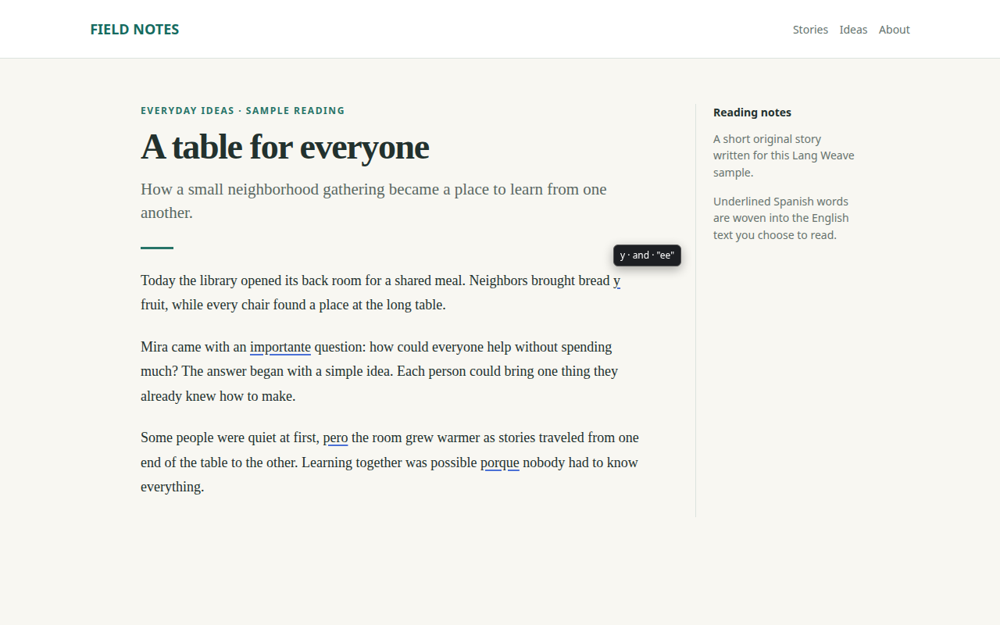

# Lang Weave

Learn a language through the English you already read. This Chrome extension replaces a few words in web pages with your target language. Hover or focus a word for its meaning and a rough sound hint. Click it, or press Enter or Space while it is focused, to flip it back to English. Spanish is the bundled default.

> The build passed **ahora**, **pero** the old cache still needs work.
> ahora = now; pero = but

A browser-focused fork of [French Weave](https://github.com/jackieoliver/french-weave) by Jackie Oliver. Lang Weave is free software under the [GNU AGPL v3 or later](LICENSE). The upstream history and its [MIT license](LICENSE-MIT) are preserved (see [NOTICE](NOTICE)). No terminal plugin, Python setup or native messaging host is required.

This describes version 0.12.22. There is no Chrome Web Store release yet. You load the extension unpacked, as below.

## Install in Chrome

Chrome 140 or newer is required. The extension stores your Gemini key where only extension pages can read it, and it refuses to take or use a key in a Chrome that cannot do that.

1. Clone this fork: `git clone https://github.com/tedks/lang-weave.git`.
2. Open `chrome://extensions`, enable **Developer mode**, choose **Load unpacked**, and select the repository's `extension` folder. No build or dependency installation is needed. Keep that folder in place after loading it.
3. A welcome tab opens on a fresh install. It shows a short demo with bundled words and no network call. Then it asks where Lang Weave may read: **Only sites I turn on** (recommended) or **All sites except sensitive ones**. The second choice asks Chrome for access to all websites. Until you choose, nothing is sent to Gemini. Profiles saved before this page existed keep the access they already had.
4. Open **Settings** from the toolbar popup, paste your own [Gemini API key](https://aistudio.google.com/apikey), then **Save key** and **Test key**. Testing sends one short prompt to Gemini. The key is kept in extension storage and is never sent to web pages.
5. Turn Lang Weave on for a site with the checkbox in the popup, and accept Chrome's permission prompt. Skip this under **All sites**. The development build also declares x.com and twitter.com in its manifest, so they need no grant. Reload a page that was already open.

Spanish works at once. Settings also lets you generate a local experimental pack for another language code, up to five at a time (see Learning).

**Updating.** Because this is an unpacked install, Lang Weave checks its own folder every 30 minutes. When you pull a newer version, it reloads itself once, after any work in flight. If that fails, the toolbar icon shows **NEW** and Settings says to click the reload arrow on `chrome://extensions`. A Web Store build would not do this, because Chrome would update it.

**One ID.** Since 0.12.0 the manifest carries a public key, so Chrome gives Lang Weave the ID `lkbkmlgogcpcacjmdmoecgacdbfddbnh` from any folder on any machine. Chrome will not run two copies with that ID in one profile, so use a separate profile for a development checkout. Lang Weave and the inherited French companion do not share browser storage.

**Fleet machines** install through the dotfiles installer. Its move to a `lang-weave` path, `${XDG_DATA_HOME:-$HOME/.local/share}/lang-weave/extension`, is tedks/dotfiles#225 and was still open when this was written. Check it before relying on that path.

### Upgrading from before 0.12.0

Every install loaded before 0.12.0 has an ID derived from its folder. Version 0.12.0 arrives as a new extension with empty storage, and your progress moves across once, through a Learning backup. Skip this if you never loaded an earlier version.

**Do not update the old folder to 0.12.0 or later.** Version 0.11 reloads itself when its files change. If the old folder receives a keyed version, Chrome switches it to the new ID and turns the old entry off, with its progress still stored under the old ID. To recover, put the 0.11 files back in that folder and turn the old entry on again. Never remove that turned-off entry, because removing it deletes its progress. If you load Lang Weave from a git checkout, export before you pull. [The stable ID mission record](docs/STABLE-ID-MISSION.md) has the evidence and what remains untested.

1. Check the old install's version in `chrome://extensions`. Export needs 0.11.0 or later. If it is older, first update the old folder to 0.11.1, the last release without the key, for example with `git checkout ac71cb7`. A keyless update keeps the old ID and its progress.
2. Turn off the **On** switch in the old install's popup, not its `chrome://extensions` toggle, so the two installs do not both weave pages. Then open **Learning backup** from that popup and download the JSON file. The switch is not part of the backup.
3. Open `chrome://extensions`, choose **Load unpacked**, and select the new `extension` folder from a separate clone. It appears as a second Lang Weave entry with ID `lkbkmlgogcpcacjmdmoecgacdbfddbnh`.
4. Do not enter a Gemini key in the new install yet. Import only accepts a target with no key and no progress of its own. Choosing a site policy on the welcome page does not block import. If you already entered a key or read with the new entry, remove that new entry and load the folder again. That resets only the new entry.
5. In the new install, open **Settings**, then **Your data**, then **Learning backup**. Choose the file, review the counts and preferences, and confirm the import.
6. Check the restored review queue. Then enter your key and choose your sites again, because a backup excludes keys and site permissions.
7. Only now remove the old entry. Removing it deletes its browser storage.

## Controls and privacy

**Popup.** The **On** switch pauses weaving and restores the original text in open pages. The site checkbox controls the current hostname. Below them are a Today line, the days you practised this week with your verified-known count, and one button. The button reads **Review N due words**, **Add words** or **Practice**. Links open **Settings**, **My words** and this section. If a saved introduction date is more than seven days ahead of your clock, the popup offers to reset only that day's introduction budget.

**Toolbar badge.** The icon says why Lang Weave is or is not working on the current tab, with fixed text and no page or host data. A **!** means setup, a key, or a rejected key needs attention. A **•** means this site needs your OK. A **–** means Lang Weave is not reading here: it is paused, the site is off or sensitive, the model is cooling down, or the daily call limit is reached. Reviews still work then. No mark means it is working. Hover the icon for the reason in words. Where Chrome withholds a tab's address, the tooltip says to open Lang Weave to check the page.

**Keyboard.** Alt+Shift+W pauses or resumes Lang Weave on the current site, but only when the tab is active and the site already has access. It toggles a site that is on, or one you turned off yourself. A site that starts off needs the popup. Alt+Shift+R opens review. Both are suggestions that you can change at `chrome://extensions/shortcuts`.

**Settings.** The options page holds:
- **Learning:** language, reading level, gradual learning, new words per day, translation density and inline recall.
- **Sites and privacy:** the site policy under **Other sites**, an **Allow all websites** button, and per-site exceptions you can reset one by one.
- **Gemini:** model, key, and the Save, Test and Remove buttons.
- **Your data:** Learning backup, My words, Personal entries, and **Clear cache**.
- **About:** version, license and credits.

**What is sent.** Readable text from enabled, permitted sites, including eligible personal vocabulary as candidate forms, goes to Google's Gemini API with your key. Links and inline code may be included as sentence context but are never changed. Forms, editable text and code blocks are skipped. Sensitive sites start off under either site policy: webmail, messaging, AI chat, password managers, banking, health, government and local addresses. The blocklist is a heuristic and cannot recognize every private page, so use **Only sites I turn on** for tighter control. Pages whose title or text obviously concerns health, law, money, emergencies, crime or driving are also skipped. Those checks are finite word lists, and ambiguous text stays English.

**Which Gemini terms apply.** Lang Weave has no server, account or telemetry, so no Lang Weave server sees your reading. Google does. With a free key, Google may use requests to improve its products, and human reviewers may read them. A billed key avoids that use, though provider quotas and charges still apply. Google's [API terms](https://ai.google.dev/gemini-api/terms) say users must be 18 or older. They also say paid services only may be used for users in the European Economic Area, Switzerland and the United Kingdom. Lang Weave cannot tell whether your key is billed. Read the terms for your account and region before enabling it on private reading. The extension limits itself to 1,000 model calls per local day, which is a request cap and not a spending limit. The default model is Gemini 3.5 Flash-Lite. Gemini 3.8 Flash is available in Settings and falls back to Flash-Lite on failure. A QA pass on 2026-10-15 found that on free keys 3.8 Flash mostly answered 503 or timed out.

**What stays in your browser.**
- Settings and cached replacement choices. Cached choices contain short English fragments, and about 5,000 are kept. **Clear cache** forgets them without touching learning progress.
- Review cards and their schedule.
- Up to 500 word events per target, each a word, a kind (seen, peek or flip) and a date.
- A learning log. Each review adds a word ID, a time, an outcome and some numbers: response time, days since the last review, the scheduled interval and predicted recall. Each word also keeps counts of sightings and peeks with first and last day. It never holds pages, URLs or text.
- Coarse per-word encounter counts that guide gradual learning.
- Up to five generated vocabulary packs and your personal entries.

Apart from the key, which authenticates your requests to Google, none of this stored history is sent anywhere. Each model request does carry the page text and a list of candidate vocabulary: target forms and English glosses from the bundled pack, a generated pack, or your personal entries. For the bundled pack it also tells Gemini which candidates you are still learning and which you treat as known. Removing the extension clears the stored data. A Learning backup copies the learning part of it into a file that you control. It leaves out the key, site choices and caches, and it may drop log entries that do not fit its size limit, which the import preview counts. There is no Duolingo login, account sync or tab takeover.

**Your own words.** Select a word or short phrase in readable text on an enabled, permitted site and choose **Add to Lang Weave** from Chrome's selection menu. Say whether the selection is English or the target language. Check any local suggestion or enter both forms yourself, then press **Save personal entry**. The menu and Save do not call Gemini or an online dictionary. **Personal entries** lets you find entries, add one to manual review, archive or unarchive it without losing history, and export your entries and history as local JSON. A saved entry does not spend a daily introduction or count as practice. With gradual learning on, an unambiguous single-word entry may enter the normal budgeted reading flow when it appears in a passage. Phrases and unresolved collisions stay available for manual review only. The bundled suggestions have not been checked against a dictionary.

**Learning backup.** **Settings**, then **Your data**, then **Learning backup** downloads one JSON file of your learning progress, personal entries, generated packs and learning preferences. Export only reads local state. The file excludes keys, host grants, site choices, consent, caches, quotas, page text and one-use tickets. Import goes into a separate, keyless install whose target has only initialized defaults. It refuses conflicts instead of merging or replacing, and it previews counts and preferences before you confirm. An unverified card from an old removed pack blocks the whole export rather than risk page text in the file. Backups from 0.12.6 on use format 2. This build reads formats 1 and 2. Build 0.12.5 can import format 2, and 0.12.4 and earlier cannot. Once 0.12.6 has logged anything, 0.12.4 and earlier can no longer export. If you go back, go back to 0.12.5. [The backup contract](docs/STORE-PORTABILITY-MISSION.md) lists the supported keys and exclusions.

## Learning

**Reading.** **Reading level** chooses the bundled vocabulary: **Beginner** (30 words) or **Expanded** (226 words, including the Beginner words). These are not CEFR grades. **Translation density** (Light, Normal or Heavy) limits how many words are woven into a passage. A model picks the Spanish word that fits the context. Deterministic validation rejects unlisted words and mismatched glosses, but a model can still make a contextual or grammatical mistake. This is mixed-language reading, not full-sentence translation.

The gloss appears after a 700 ms pause, so you have a beat to recall the word first. Seeing it counts as a peek, which is weak evidence that you needed the meaning.

**Gradual learning** is off by default, and the welcome page recommends turning it on at 5 new words a day. With it on:
- Only a bounded number of new words are introduced per local day, 1 to 10 in Settings. A word counts only once it is actually visible on the page.
- Due words come first, then weak ones, then learning words met on fewer than eight days in their first three weeks, then other learning words, then new words. Among new words, a lower frequency band comes first, with the Beginner 30 at band 0, and Spanish cognates break ties.
- A learning word seen three times in one local day is left out of requests for the rest of that day. Two same-day peeks on a learning word you have already rated bring its review forward to within 24 hours.
- Across one request, new, due and learning swaps are capped near 2% of the words read, with a minimum of one, whatever the density.
- A pile of five or more due or weak words pauses new introductions.

**Inline recall** is off by default and needs gradual learning. A due word then shows as English with a dashed underline and a small ?, at most two at a time. Activating one lets you reveal the Spanish and rate your recall without leaving the page.

**Reviews** need no key and no network. The popup's main button opens the recall page when words are due or available. It shows the English meaning, you say the target word, reveal it, and rate **Again**, **Hard**, **Medium** or **Easy**. Space or Enter reveals, and 1 to 4 rate. With gradual learning on, **Already know** is a claim that counts as verified only after one later check. **Add 5 new words** brings in up to five bundled words from your reading level. Sightings, hints and flips while reading never count as recall.

Reviews are scheduled with FSRS-6 on the actual time since each review, aiming for 90% recall. The code accepts a target of 85% to 90%, but Settings has no control for it yet. A lapse keeps a word's history. Again returns in 10 minutes, and a new word rated Hard, Medium or Easy returns in 1, 2 or 8 days. Intervals are capped at 365 days. An old card keeps its due date and moves to FSRS at its next rating. With gradual learning on, a word rated Easy three times in a row moves to occasional maintenance reviews. Maintenance cards stay in the schedule.

**My words** lists every word's stage and next review, with search and a stage filter. Stages are new, learning, maintenance (long-interval reviews: stability of 21 days or more, or a card flagged for maintenance), marked known (your claim), and verified known (recalled after a gap of 21 days or more, within the card's current life). You can practise a word early, mark it known, reset it after a confirmation, or archive a personal entry. **Is this working?** shows measurements from your own reviews on this device, each marked "not enough data yet" until it has enough: next-day recall, retention after three weeks against your target, predicted against actual recall, hard words, meetings while reading, and workload.

**The vocabulary** is a curated starter set, not a certified curriculum or a native-speaker review. Each bundled word also carries a coarse frequency band, which orders new words. The first Expanded addition selects 79 everyday nouns from an upstream AI-drafted list. [Selection, credits and limits](docs/UPSTREAM-CURRICULUM-MISSION.md) are documented. The selection and approximate sound hints lean Latin American. Spanish accents and ñ are preserved, and generated target forms are matched exactly.

**Other languages.** In Settings, **Add a language**, enter a code such as `fr` or `ja`, and generate a local experimental pack with Gemini. It needs your key and a chosen site policy, and it counts toward the daily call cap. Quality is not certified. Each pack has its own progress and reviews. **Remove this generated language** frees a slot and deletes that pack's reading and review progress. Personal entries and their history stay under the target language.

**Accessibility.** A swapped word carries its language code, and its accessible name is the word alone. The gloss and action are an `aria-describedby` description. The interface text is English only. Worker-sent text and the selection-menu title stay English as well.

## Development

Runtime dependencies: none. Tests use Bun and happy-dom. The browser gates use Playwright Chromium with a synthetic Gemini response, with no API key or paid calls.

```sh
cd extension
bun install --frozen-lockfile
bun test
bunx playwright install chromium
bun run test:browser
```

The other Chromium gates are the scripts in `extension/e2e`, run with `node`, for example `node e2e/gradual.mjs`. A candidate-vocabulary build pipeline under `scripts/curriculum` is pinned, offline and reproducible, and it ships no new vocabulary rows. See [docs/CURRICULUM-PIPELINE.md](docs/CURRICULUM-PIPELINE.md). The inherited Python tests run from the repository root with `python3 -m unittest discover -s tests`. A change to a shipped file needs a version bump, and the version files must agree. Check both with `python3 tests/check_version_bump.py --base origin/main`.

`node extension/scripts/package.mjs` zips what ships. Add `--store` for the Chrome Web Store build. That build drops the x.com content script, the web-accessible resources and the `alarms` permission, so it has no self-update check. It also bundles the content script into one file. Its listing screenshots are in [docs/store-assets](docs/store-assets/README.md).



See [AGENTS.md](AGENTS.md), [design boundaries](docs/DESIGN.md), [mission evidence](docs/MISSION.md), the [changelog](docs/CHANGELOG.md) and the [roadmap](docs/ROADMAP.md).

## Next

Planned, and not built yet, in [the roadmap](docs/ROADMAP.md): a Chrome Web Store listing, Firefox support, a larger and reviewed vocabulary, typed or multiple-choice recall, and optional audio. A site takeover screen and Duolingo level import remain follow-up ideas. Duolingo integration needs a supported method or an export. It must not collect a password or browser session token.

The original CLI hooks, slash commands, ready-made French blocks and native-host scripts are retained for upstream comparison. They remain French-oriented and are outside this fork's browser product. See the [upstream reference](docs/UPSTREAM.md).
