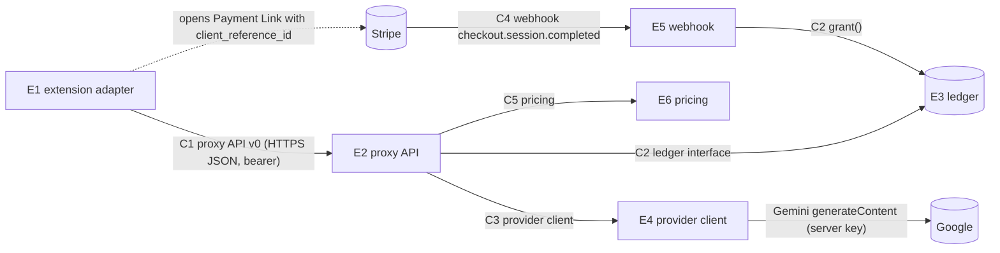

# Managed key — design spec (DRAFT, preparation only)

Status: draft for council and for Ted. Nothing here is authorized to launch. The hold in the
mission record stands: no account, no spend, no deploy, no store submission, no live key.
Author: LW-STORE lead (Claude Opus 5.5), 2026-11-28. Baseline: `main` 39b264a, extension 0.16.1.

## 1. Overview

Today every reader pastes their own Gemini API key ("BYOK"). The service worker sends up to
eight near-viewport passages straight to `generativelanguage.googleapis.com` with the key in
`x-goog-api-key` (`extension/src/gemini.js:24-29`, `extension/src/reading.js:231-275`). No
Lang Weave server exists, and the listing promise is "no account, progress stays in your
browser".

The managed key is an optional second path: the reader buys prepaid credit from Lang Weave,
and a small hosted proxy holds the provider credential, checks the reader's balance, makes the
model call, and debits the actual cost. BYOK stays the default and stays free with no feature
gated.

The point of this document is to decide whether that path is worth building, what the
smallest honest version is, and what has to be true before it takes a first dollar. Section 9
argues it is **not yet** worth launching: there are no outside users today.

## 2. Goals and non-goals

Goals, in priority order. A worker adjudicates a deviation against these.

1. **The reader can never be charged more than they prepaid.** Every model call is preceded by
   an atomic reservation of its worst-case cost against the reader's balance. No reservation,
   no call. There is no postpaid, subscription or auto-top-up path in v0.
2. **The operator can never lose more than a fixed daily amount.** A global daily provider
   spend ceiling, checked in the same reservation, stops all managed calls when reached.
3. **BYOK is untouched.** With the flag off (the default), the shipped extension behaves
   byte-for-byte as 0.16.1 on every network path. Managed mode is a separate provider value,
   never a silent fallback in either direction.
4. **No new reader data at rest.** The proxy stores no page text, no URLs, no titles, and no
   model output. It stores an opaque account id, a hash of the bearer token, a balance, a
   ledger of (time, model, token counts, cost), and the Stripe ids needed for refunds.
5. **Not an open model relay.** The proxy accepts only Lang Weave's structured swap inputs
   with bounded sizes, builds the prompt itself from the extension's own modules, and fixes
   the model allowlist, the response schema and the output cap. No client-supplied
   instruction text ever reaches the model.
6. **Testable without the network.** Every boundary has a stub: a stub provider, Stripe test
   fixtures with locally computed signatures, and an in-memory ledger.

Non-goals for v0: accounts with email or passwords; cross-device sync; subscriptions; free
trial credit; generated-language-pack creation and the key test through the proxy; Firefox;
any model other than the ones the extension already allowlists; analytics of any kind.

## 3. Firewalled entities

| Entity | Owns | Must not know |
|---|---|---|
| **E1 Extension managed-provider adapter** (`extension/src/managed.js`, flag-gated) | Token storage, sending the structured inputs `requestSwaps` already has, mapping proxy errors onto the existing `category` set | The provider key; Stripe |
| **E2 Proxy API** (`proxy/src/api.js`) | Auth, request validation, reservation, calling E4, settlement, error mapping | Page text after the response returns; card data |
| **E3 Ledger** (`proxy/src/ledger.js`, storage interface) | Balances, reservations, settlements, credit grants, idempotency of grants | Request content |
| **E4 Provider client** (`proxy/src/provider.js`) | The one outbound model call, timeout, reading `usageMetadata` | Accounts, balances |
| **E5 Stripe webhook** (`proxy/src/stripe.js`) | Signature verification, turning a paid Checkout session into exactly one credit grant | Request content |
| **E6 Pricing table** (`proxy/src/pricing.js`) | Per-model prices, markup, worst-case reservation formula | Everything else |

E2 depends on E3, E4, E6 only through their published interfaces, so each can be replaced by a
stub in tests.

## 4. Boundary diagram



## 5. Contracts

### C1 — Proxy API v0 (owner E2; consumer E1)

All requests are HTTPS, JSON, `Content-Type: application/json`, at most 64 KiB. Responses never
echo request text. Every error body is `{"error": {"category": <string>, "retryAfterMs"?: <int>}}`
with `category` drawn from the extension's existing set in `quota-status.js` plus three new
values: `managed_balance`, `managed_unauthorized`, `managed_unavailable`.

- `POST /v0/accounts` → `201 {"accountId": "acct_<26 base32>", "token": "lwk_<43 base64url>"}`.
  No body. The token is 256 random bits, returned exactly once; the proxy stores only
  `SHA-256(token)`. Rate limit: 5 per IP per hour (`429 rate_limit`). A new account has balance 0.
- `GET /v0/balance` with `Authorization: Bearer <token>` → `200 {"balanceMicros": <int>,
  "reservedMicros": <int>}`. Unknown token → `401 managed_unauthorized`.
- `POST /v0/swaps` with bearer token and a **structured** body; the proxy builds the prompt
  itself (6.2):
  ```json
  {"promptVersion": "0.16", "model": "gemini-3.5-flash-lite", "level": 1, "language": "es",
   "density": "normal", "unknownLimit": 3 | null,
   "words": [{"fr": "ventana", "en": "window", "status": "active"}],
   "shownToday": ["ventana"],
   "passages": [{"id": "p1", "text": "..."}]}
  ```
  → `200 {"text": <candidate text>, "usage": {"promptTokens", "outputTokens", "thoughtTokens"},
  "costMicros": <int>, "balanceMicros": <int>}`.
  Validation, all before any reservation: `promptVersion` is one the deployed proxy carries
  (otherwise `409 managed_update_required`); model in the allowlist; `level` 1 or 2;
  `language` is a code the proxy's language table knows; `density` one of the three values;
  at most 8 passages, each `id` at most 64 characters and `text` at most 2,000 characters (the
  extension's own batch caps, `background.js`); at most 400 words, each `fr`/`en` at most 48
  characters matching `^[\p{L}\p{M}' .-]+$`u and `status` from the extension's status set;
  `shownToday` at most 400 such forms; the built system plus user text at most 30,000
  characters. The proxy then calls the **same** `buildSystemPrompt`,
  `buildUserContent`, `buildRequest` and `RESPONSE_SCHEMA` the extension uses, imported from
  `extension/src/` at the commit the proxy was deployed from, and sets
  `generationConfig.maxOutputTokens` to its own cap. Any violation → `400 request_failed`
  with no provider call.
  Errors: `402 managed_balance` when the reservation fails; `503 managed_unavailable` when the
  global ceiling is reached or the proxy is in maintenance; provider 429/503/timeout map to the
  existing `rate_limit` / `overloaded` / `request_failed` with `retryAfterMs` passed through
  when bounded.
- **Invariants:** a 200 or a provider error is always preceded by exactly one successful
  reservation and followed by exactly one settlement or release. A 4xx from validation, auth or
  balance never calls the provider. `costMicros` on a 200 is at most the reservation.
- **Intentionally unspecified:** latency, the exact token cap, the markup, which provider
  route the proxy uses. Consumers must not parse `text` beyond `parseSwapsResponse`.
- **Versioning:** the path prefix carries the version. Adding an optional response field is
  compatible; anything else is `/v1`.

### C2 — Ledger interface (owner E3; consumers E2, E5)

Amounts are integer **micro-dollars** (1 USD = 1,000,000). No floats anywhere in money.

- `createAccount(tokenHash) → accountId`
- `reserve(accountId, worstMicros, dayKey, globalCeilingMicros) → reservationId | BALANCE | CEILING`
  — atomic: succeeds only if `balance - reserved >= worstMicros` **and** the day's global
  `spent + reserved + worstMicros <= ceiling`. Implemented as one conditional `UPDATE` per row in
  a single transaction.
- `settle(reservationId, actualMicros, reason)` — `actualMicros` is clamped to `[0, worstMicros]`;
  moves that amount from reserved to spent, releases the rest, and records any unclamped excess
  as operator `overage` (the reader is never charged it). Idempotent per reservation id.
- `release(reservationId)` — releases the whole reservation. Idempotent.
- `grant(stripeEventId, accountId, micros)` — adds credit once per Stripe event id; a replay
  returns the original result and changes nothing.
- `expireStale(olderThanMs)` — a reservation older than 5 minutes with no settlement is
  **settled at its worst case** (see 6.3 for why), recorded with reason `timeout`.

### C3 — Provider client (owner E4; consumer E2)

`call({model, request, timeoutMs}) → {text, usage} | ProviderError{status, category, retryAfterMs}`.
The server credential is read from the environment at start; it is never logged, never put in
an error, and never returned. `usage` is read from `usageMetadata`
(`promptTokenCount`, `candidatesTokenCount`, `thoughtsTokenCount`). When `usageMetadata` is
missing, `usage` is `null` and E2 settles at the worst case.

### C4 — Stripe webhook (owner E5; producer Stripe)

`POST /v0/stripe/webhook`. The raw body is verified against `Stripe-Signature` with the endpoint
secret and a 300-second tolerance before it is parsed. Only `checkout.session.completed` with
`payment_status: "paid"` and `mode: "payment"` grants credit. The account is
`client_reference_id`, which must match `^acct_[A-Z2-7]{26}$` and exist. The grant amount comes
from the proxy's own price-to-credit table keyed on the Payment Link / Price id, **never** from
the amount in the event. Every other event type returns 200 and does nothing. Refunds and
disputes (`charge.refunded`, `charge.dispute.created`) are recorded for an operator to act on in
v0; they do not automatically claw back credit.

### C5 — Pricing (owner E6; consumer E2)

`worstCaseMicros(model, systemChars, userChars, maxOutputTokens)` and
`actualMicros(model, usage)`, both rounding **up** to the next micro-dollar, both including the
markup. Input tokens are bounded above as `ceil(chars / 2)` for the worst case [assumption, to be
checked against `countTokens` and real `usageMetadata` in M1: a token of English or Spanish
prose or JSON is rarely under two characters]. Output is bounded by `maxOutputTokens`; whether
that cap also bounds thinking tokens on 3.5 Flash-Lite is unverified, so any excess is recorded
as operator overage (C2). The table is data with a
`checkedOn` date and the price source URL; a test fails if the date is older than 90 days.

## 6. Design choices and why

### 6.1 Prepaid credits, not a subscription

Recommendation: **prepaid credit packs through a Stripe Payment Link**, starting with one $5
pack.

- A balance is the hard per-reader bound in goal 1. A subscription still needs a usage cap,
  plus proration, renewal failure, cancellation and dunning: more code and more support.
- Usage varies by two orders of magnitude between readers (an hour of X scrolling is 40–60
  calls, a long article about 4; the local cap is 1,000 calls a day: `quota.js:4`). A flat
  subscription either loses money on heavy readers or overcharges light ones.
- A Payment Link takes `client_reference_id` as a URL parameter, so the proxy never creates a
  Checkout session and never talks to Stripe outside the webhook. Stripe hosts the card page;
  Lang Weave never sees card data.
- Unspent credit is a liability and may be refundable on request; v0 says so plainly and does
  not expire credit.

### 6.2 Server-built prompt, not a pass-through

The proxy takes Lang Weave's structured inputs and builds the prompt itself, with the same
modules the extension ships. It never runs a client-supplied system instruction.

Two reasons. First, the contract: the Google APIs Terms forbid creating "an API Client that
functions substantially the same as the APIs and offer[ing] it for use by third parties"
(section 10). An endpoint that runs any client-supplied system prompt under a fixed schema is
uncomfortably close to that line; an endpoint that only turns passages and a word list into
swaps is plainly an application. Second, abuse: with the prompt fixed, the only free text is
the passage itself, which is exactly the content any reading app must accept.

The version-skew cost is handled by `promptVersion`. The proxy is deployed from a release
commit and carries the prompt modules of that release and the one before it. An extension
ahead of the proxy gets `409 managed_update_required`, which the adapter shows as "Managed
reading is updating; try again later". BYOK readers are unaffected. The extension still
validates every swap (`engine.js:37-40`).

### 6.3 Metering by outcome, not by `usageMetadata` alone

Google's billing FAQ says HTTP 4xx and 5xx responses are not billed, and that an HTTP 200
with `finishReason: SAFETY` bills input but not output. It also warns that `usageMetadata`
can carry `promptTokenCount` on a 200 whose input was not charged. So settlement keys on the
outcome:

| Outcome | Reader charged |
|---|---|
| Validation, auth, balance or ceiling failure | nothing; no reservation or provider call |
| Provider HTTP 4xx/5xx | nothing; reservation released |
| HTTP 200, `finishReason` `STOP` or `MAX_TOKENS` | input + output + thinking from `usageMetadata`, priced by E6, clamped to the reservation |
| HTTP 200, `finishReason` `SAFETY` or other blocked class | input only |
| HTTP 200 without `usageMetadata` | the reservation (worst case), reason `no_usage` |
| Timeout or connection loss after the request was sent | the reservation (worst case), reason `timeout` |

The last two rows charge the reader for a call Google may have billed. Charging zero would make
the operator's loss unbounded under retry loops. The per-call worst case is under one cent
(section 10), the extension already backs off on timeouts (`engine.js:8-11`), and the ledger
shows the reason. Any usage above the reservation (for example, if thinking tokens are not
bounded by `maxOutputTokens`) is the operator's `overage`, never the reader's.

### 6.4 Anonymous bearer token, no email

The token is the account. It sits in `chrome.storage.local` under the same trusted-context
access level as today's API key (`background.js:81-89`). A lost token loses the balance unless
the reader asks support with their Stripe receipt; the operator can then move the balance to a
new account id by hand. This keeps "no account" true in the sense readers care about (no login,
no email held by Lang Weave) while being honest that Stripe holds the purchaser's email and
card details under Stripe's own terms.

## 7. Abuse and key-leak risks

| Risk | Effect | v0 control | Residual |
|---|---|---|---|
| Provider credential leaks from the proxy | Unbounded spend on the operator's account | Credential only in the host's secret store; never logged; restricted to the one API; global daily ceiling in the ledger; provider-side budget alert | Provider budget alerts notify, they do not stop spend; ceiling only covers calls that pass through the proxy. Rotate on any suspicion. |
| Reader's bearer token stolen (malware, synced profile, shared machine) | Thief spends that reader's balance | Balance is the bound; token revocation endpoint is v1; operator can revoke by hand | Same exposure class as today's BYOK key, but bounded by a prepaid balance instead of the key's quota |
| Proxy used as a cheap general LLM, or read by Google as resold API access | Content-policy and contract exposure for the operator | Server-built prompt; only passages and validated word forms are free input; fixed schema, model allowlist, size caps, output cap, prepaid only | Instructions inside passage text can still steer string fields. Bounded by balance and the cap, and the same as any reading app. |
| One project's provider quota and spend cap | All managed readers pause together; on AI Studio Tier 1 the billing account pauses at $250 a month | Global daily ceiling well under the tier cap; one project, honest quota-increase requests (splitting projects to multiply quota is circumvention under both contracts) | A busy day returns `managed_unavailable` to everyone |
| Card testing on the Payment Link | Stripe fees, disputes | Stripe Radar defaults; one fixed-price pack; no free credit | Dispute fees per incident |
| Chargeback after spending | Loss of up to one pack plus the dispute fee | Pack size bounds it | Accepted |
| Sybil accounts | Ledger rows | Accounts start at zero; per-IP rate limit on creation | Harmless rows; periodic deletion of zero-balance accounts older than 30 days |
| Prompt injection from page text | Bad swaps | Response schema plus existing client validation (`validateSwaps`) | Unchanged from BYOK |
| Replay of a Stripe event | Double credit | `grant` idempotent on event id | None known |
| Clock or retry races in reservation | Overspend | One transaction per reservation; settlement clamps | Covered by boundary tests |

## 8. Privacy, store and provider implications

**Privacy promise changes.** Today: "no Lang Weave server sees your reading". In managed mode,
the proxy receives passage text in transit. The policy and listing must say so in plain words
and must keep the BYOK statement intact for BYOK readers. Managed calls go through a billed
provider account, which changes the Google data-use terms that apply to the passage text
(section 10 quotes them). The store data disclosure gains "website content transmitted to the
developer's server", "authentication information" (the token) and "financial and payment
information: processed by Stripe, not collected by Lang Weave". Limited Use must be restated.

**In-extension payment.** The Chrome Web Store no longer offers its own payments; an extension
may send readers to an external payment page, and the listing must disclose paid features.
Section 10 quotes the current policy text and the publisher-identity requirements that start
when an item offers paid features.

**Provider terms.** Section 10. In short, whether an AI Studio key may back a consumer product
sold by Lang Weave is the decision that gates everything else.

## 9. Demand: be sceptical

There are no known outside users. The scout run on the night of 2026-11-28 found none; every install observed in
the mission record is the owner's fleet. The category record is poor: Toucan sold to Babbel and
stopped shipping, Lingua.ly closed, and a published freemium-extension report shows about 0.8%
of all users converting (`docs/research/market.md`, "Monetization"). At 0.8%, covering even a
$5/month fixed hosting bill at a $2 margin per pack needs a few hundred active readers.

Evidence that would change this, in the order it could arrive:

1. A free BYOK listing exists and the Store dashboard shows **at least 200 weekly users for four
   consecutive weeks**. Until then the managed path has nobody to sell to.
2. **At least 20 distinct readers** take an explicit "I'd rather pay than get a key" action: a
   link on the key step to a static page with a GitHub discussion or a mailto. It is counted by
   hand, not by telemetry.
3. Of the readers who reach the key step, **more than half abandon it** (visible as Store users
   without a key, which only a reader can tell us: ask in the discussion). That would mean the
   key is the bottleneck the managed path removes.

If (1) never happens, the managed path does not matter. If (1) happens without (2) or (3), the
cheaper fix is a better key flow, not a server.

## 10. Provider terms, pricing and unit economics

Full quotes, URLs and dates are in `docs/research/managed-key-terms-2026-11-28.md`, fetched on
the night of 2026-11-28. This section gives the governing clauses and what they mean for the
design. None of it is legal advice; section 13 lists what only a lawyer or Google can answer.

### 10.1 What the provider terms allow

**No published clause requires a separate written agreement with Google** for a server that
holds a Gemini credential and serves Lang Weave's own readers, on either route below. Both
routes forbid reselling the model itself. Which side of that line Lang Weave sits on depends
on the proxy's shape, which is why 6.2 builds the prompt on the server.

- **Google APIs Terms of Service** (last modified 2021-11-09), section 4(a): you may not
  "Sublicense an API for use by a third party. Consequently, you will not create an API Client
  that functions substantially the same as the APIs and offer it for use by third parties."
  Section 3(a): "The APIs are designed to help you enhance your websites and applications
  ('API Client(s)')." <https://developers.google.com/terms>
- **Gemini API Additional Terms** (effective 2026-03-23), Use Restrictions: "Use of Google AI
  Studio and Gemini API is for developers building with Google AI models for professional or
  business purposes, not for consumer use." and "You may use only Paid Services when making API
  Clients available to users in the European Economic Area, Switzerland, or the United
  Kingdom." Age Requirements: "You must be 18 years of age or older to use the APIs. You also
  will not use the Services as part of a website, application, or other service ... that is
  directed towards or is likely to be accessed by individuals under the age of 18."
  <https://ai.google.dev/gemini-api/terms> (now served at aistudio.google.com/docs/terms)
- **Paid vs unpaid data use**, same terms: on Unpaid Services Google uses submitted content "to
  provide, improve, and develop Google products" and "human reviewers may read, annotate, and
  process your API input and output"; on Paid Services Google "doesn't use your prompts ... or
  responses to improve our products" but "logs prompts and responses for a limited period of
  time, solely for detecting and preventing violations of the Prohibited Use Policy". A managed
  key is always a paid project, so a managed reader's passages get the paid-tier treatment, which
  is **better** than what a free-key BYOK reader gets today.
- **Google Cloud Terms of Service** (Vertex AI route, last modified 2026-11-18), 1.1: Customer
  "may use the Services, and integrate the GCP Services ... into any Customer Application that
  has material value independent of the Services". 3.3: Customer will not "(c) sell, resell,
  sublicense, transfer, or distribute any or all of the Services" or use them "in a manner
  intended to ... circumvent Service-specific usage limits or quotas", including "creating
  multiple ... Projects to simulate or act as a single ... Project".
  <https://cloud.google.com/terms>

Reading: the AI Studio route works but carries the unresolved "not for consumer use" sentence
and account-wide spend-cap pauses ($250 a month on Tier 1, per the rate-limits page). The
Vertex route has an express permission for exactly this ("Customer Application that has
material value independent of the Services"), defined End Users and no consumer-use sentence;
its global endpoint costs the same as AI Studio. **Recommendation: Vertex AI global endpoint for
a real managed key.** The 18+ clause applies to both routes and to BYOK already.

### 10.2 The alternative that holds no money

OpenRouter's OAuth PKCE flow gives each reader a key tied to their own OpenRouter account, with a
credit limit they control; "Their requests are billed to their own OpenRouter credits, so you
don't pay for their inference or manage keys on their behalf"
(<https://openrouter.ai/docs/guides/overview/auth/oauth>). It serves `gemini-3.5-flash-lite` at
Google's list price. Lang Weave would hold no key, no money, no ledger and no stored value, and
needs no Stripe account, trader status or physical address. Its costs: a second provider client
in the extension, an OpenRouter account and card for each reader, and OpenRouter's terms, which
make unused credit non-refundable after 24 hours. It removes the key-setup friction without
making Lang Weave a seller. **If the problem to solve is key friction rather than revenue, this
is the better first step**, and DECISIONS.md asks Ted which problem he means.

### 10.3 Prices (Gemini Developer API, paid Standard tier, read 2026-11-28; the page carries no date)

| Model | Input / 1M | Output incl. thinking / 1M |
|---|---|---|
| gemini-3.5-flash-lite (extension default) | $0.30 | $2.50 |
| gemini-3.8-flash | $0.75 until 2026-12-31, then $1.50 | $3.75, then $7.50 |

"When thinking is turned on, response pricing is the sum of output tokens and thinking tokens."
Managed v0 allowlists **only 3.5 Flash-Lite**; 3.8 Flash doubles in price on 2027-01-01.

### 10.4 Per-call cost

**No token counts have ever been measured** in this project. The only measurement is request
size from PR #63 (private QA record, 2026-11-23): Expanded-level request bodies of median 3,851
bytes for one passage, 8,099 bytes for eight, and 10,691 bytes at the maximum. At about four
bytes per token that is roughly 960, 2,000 and 2,700 input tokens (a conversion estimate). Output
and thinking tokens are unmeasured; the earlier market brief assumed 600 output and 400 thinking.
Output dominates the cost, so the first thing M1 measures is `usageMetadata` on a real call
(which needs Ted's go-ahead for one paid key).

| Call | Input tok | Output + thinking tok | Provider cost |
|---|---:|---:|---:|
| Eight passages, typical (estimate) | 2,000 | 1,000 | $0.0031 |
| One passage (estimate) | 960 | 700 | $0.0020 |
| Worst-case reservation (hard bound: built prompt ≤ 30,000 chars ≈ 15,000 tok; `maxOutputTokens` 2,048) | 15,000 | 2,048 | $0.0096 |

Monthly provider cost per reader at $0.0031 a call: 20 calls a day $1.87; 50 a day $4.67; 150 a
day $14.00; the local cap of 1,000 a day $93.30. Calls per day are themselves an estimate (20 to
50 for a typical reader). This spread is why v0 sells credits, not a flat subscription: a $4.99
monthly plan loses money on a 50-call-a-day reader at this model.

### 10.5 Margin table for one $10 pack

Stripe US card pricing (read 2026-11-28): 2.9% + 30¢, plus 1.5% for international cards and $15
per dispute. On $10 the fee is $0.59 (net $9.41); on $5 it is $0.445 (8.9%), so the minimum pack
is $10. The pack grants $10 of reading priced at provider cost × markup. "Calls" assumes the
typical $0.0031 call.

| Markup | Provider cost if fully used | Lang Weave margin | Margin % | Calls per pack | Days at 20 / 50 calls |
|---:|---:|---:|---:|---:|---|
| 1.25× | $8.00 | $1.41 | 14% | ~2,570 | 129 / 51 |
| 1.5× | $6.67 | $2.74 | 27% | ~2,140 | 107 / 43 |
| **2×** | **$5.00** | **$4.41** | **44%** | **~1,610** | **80 / 32** |
| 3× | $3.33 | $6.08 | 61% | ~1,070 | 54 / 21 |

Not in the table, and each real: one $15 dispute erases about three packs' margin at 2×;
hosting, domain and the store fee are fixed costs whose current prices were **not checked
tonight**; US sales tax and EU VAT on digital services may apply from the first sale (section 13).
Recommendation: **2× markup, one $10 pack, US only**. At 2× a reader paying $10 gets about two
to three months of typical reading, which is in line with the $3 to $6 a month the category
charges (`docs/research/market.md`).

### 10.6 Payments and the store

Chrome Web Store Program Policies (last updated 2025-05-22), "Accepting Payment From Users":
"clearly and honestly describe the products or services that you are selling and conspicuously
post your terms of sale (including any refund and return policies)"; "If your Product requires
the user to pay to obtain basic functionality, you must make that clear in the description";
"You must clearly identify that you, not Google, are the seller". The account-setup page: "Only
items that offer functionality to purchase items, additional features, or subscriptions must
include a physical address." EU trader verification (since 2024-02-17) publishes the trader's
legal name and contact details to EU users. No clause found forbids opening an external Stripe
page; the policy is method-agnostic. A proxy returning swap JSON is data, not remotely hosted
code.

Stripe's Restricted Businesses list (updated 2026-09-22) has no AI category; it prohibits
"No-value-added services, including the sale or resale of a service without added benefit to
the buyer" and lists "Seller-maintained stored value or credits" as restricted ("may be subject
to limits"). Expect due-diligence questions about the credits; keep them small,
non-transferable and refundable on request.

## 11. Smallest version that could take a first dollar

The first dollar does not need the Chrome Web Store. Lang Weave already ships as a GitHub
prerelease loaded unpacked, so the first sale can be to **one consenting adult tester in the
US** on a beta build with the flag on, before any listing changes.

1. **Proxy:** E2–E6 as one small service on a serverless host with a transactional SQL store
   (one region, one project). Vertex AI global endpoint, 3.5 Flash-Lite only, global daily
   ceiling $2, per-call reservation as in 10.4. Source public in this repo, which also meets
   AGPL section 13 for a network service.
2. **Payment:** one Stripe Payment Link, $10, US cards only, with the terms-of-sale and refund
   page it links to. The extension opens it with `?client_reference_id=<accountId>`; the
   webhook grants $10 of credit once.
3. **Extension:** `managedProvider` flag (hidden setting, default off). When on: an explicit
   disclosure page before the first managed call (passages go to Lang Weave's server and then
   to Google's paid API; nothing is stored; 18 or older; US only; Lang Weave, not Google, is
   the seller; refund terms), a balance line, a "Buy $10 of reading" link, and the existing
   error UI for the new categories.
4. **Ted's part:** sections in DECISIONS.md: choose the route, open the Stripe account (KYC),
   open the cloud billing project, pick a host and domain, approve the privacy-policy revision.
   A browser-driving agent can fill most forms while he is logged in; identity verification,
   2-Step Verification and accepting terms are his.

Not in the first-dollar version: the store listing change, EU/UK sales, a second pack size,
automatic refunds, token recovery, Firefox.

## 12. Milestones and stop conditions

- **M0 (this PR):** spec and decisions, councilled. Stop if council finds a boundary error.
- **M1 tracer (draft PRs only):** extension adapter behind `managedProvider` flag, default off,
  with a stub proxy in tests; proxy with stub provider, in-memory ledger and Stripe fixtures.
  Stop if the flag cannot be shown to leave the BYOK path unchanged.
- **M2 (needs Ted):** provider agreement route chosen, Stripe account, host account, domain,
  privacy policy revision, Store disclosure revision. Nothing in M2 is authorized.
- **M3 (needs Ted):** first paid pack sold to one consenting tester, with the ceiling at a few
  dollars.

## 13. Open questions

For Ted: `docs/specs/DECISIONS.md`. For a lawyer or Google (from the research brief):

1. Does a server-built-prompt endpoint clearly fall outside Google APIs ToS 4(a)? (We think yes;
   the pass-through design was the weaker case.)
2. Does "not for consumer use" restrict the end users of an API Client, or only the developer's
   own use of AI Studio? Moot on the Vertex route.
3. Is a language-learning extension "likely to be accessed by individuals under the age of 18",
   and is an 18+ attestation enough? This already applies to BYOK.
4. Are prepaid credits stored value under US state money-transmitter, gift-card or
   unclaimed-property rules? What refund and expiry terms are required?
5. Does selling to US readers create sales-tax obligations in some states from the first sale,
   and does selling to EU readers require VAT OSS registration? (v0 is US only.)
6. Will Google raise the project quota for a sole proprietor's consumer service, and on what
   terms?
7. Unmeasured: real input, output and thinking tokens per call, calls per reader per day, and
   whether `maxOutputTokens` bounds thinking. M1 can measure the first two with Ted's own key on
   his own reading; nothing tonight did.

## Interpretations log

(empty)
