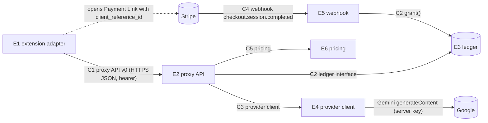

# Managed key — design spec (DRAFT, preparation only)

Status: draft for council and for Ted. Nothing here is authorized to launch. The hold in the
mission record stands: no account, no spend, no deploy, no store submission, no live key.
Author: LW-STORE lead (Claude Opus 5.5), 2026-11-28. Baseline: `main` 39b264a, extension 0.16.1.

## 1. Overview

Today every reader pastes their own Gemini API key ("BYOK"). The service worker sends up to
eight near-viewport passages straight to `generativelanguage.googleapis.com` with the key in
`x-goog-api-key` (`extension/src/gemini.js:24-29`, `extension/src/reading.js:231-275`). No
Lang Weave server exists, and the listing promise is "no account, progress stays in your
browser".

The managed key is an optional second path: the reader buys prepaid credit from Lang Weave,
and a small hosted proxy holds the provider credential, checks the reader's balance, makes the
model call, and debits the actual cost. BYOK stays the default and stays free with no feature
gated.

The point of this document is to decide whether that path is worth building, what the
smallest honest version is, and what has to be true before it takes a first dollar. Section 9
argues it is **not yet** worth launching: there are no outside users today.

## 2. Goals and non-goals

Goals, in priority order. A worker adjudicates a deviation against these.

1. **The reader can never be charged more than they prepaid.** Every model call is preceded by
   an atomic reservation of its worst-case cost against the reader's balance. No reservation,
   no call. There is no postpaid, subscription or auto-top-up path in v0.
2. **The operator can never lose more than a fixed daily amount.** A global daily provider
   spend ceiling, checked in the same reservation, stops all managed calls when reached.
3. **BYOK is untouched.** With the flag off (the default), the shipped extension behaves
   byte-for-byte as 0.16.1 on every network path. Managed mode is a separate provider value,
   never a silent fallback in either direction.
4. **No new reader data at rest.** The proxy stores no page text, no URLs, no titles, and no
   model output. It stores an opaque account id, a hash of the bearer token, a balance, a
   ledger of (time, model, token counts, cost), and the Stripe ids needed for refunds.
5. **Not an open model relay.** The proxy accepts only the Lang Weave swap request shape with
   bounded sizes, a fixed model allowlist and a fixed response schema, and it sets the output
   cap itself.
6. **Testable without the network.** Every boundary has a stub: a stub provider, Stripe test
   fixtures with locally computed signatures, and an in-memory ledger.

Non-goals for v0: accounts with email or passwords; cross-device sync; subscriptions; free
trial credit; generated-language-pack creation and the key test through the proxy; Firefox;
any model other than the ones the extension already allowlists; analytics of any kind.

## 3. Firewalled entities

| Entity | Owns | Must not know |
|---|---|---|
| **E1 Extension managed-provider adapter** (`extension/src/managed.js`, flag-gated) | Token storage, building the proxy request from the existing Gemini body, mapping proxy errors onto the existing `category` set | The provider key; Stripe |
| **E2 Proxy API** (`proxy/src/api.js`) | Auth, request validation, reservation, calling E4, settlement, error mapping | Page text after the response returns; card data |
| **E3 Ledger** (`proxy/src/ledger.js`, storage interface) | Balances, reservations, settlements, credit grants, idempotency of grants | Request content |
| **E4 Provider client** (`proxy/src/provider.js`) | The one outbound model call, timeout, reading `usageMetadata` | Accounts, balances |
| **E5 Stripe webhook** (`proxy/src/stripe.js`) | Signature verification, turning a paid Checkout session into exactly one credit grant | Request content |
| **E6 Pricing table** (`proxy/src/pricing.js`) | Per-model prices, markup, worst-case reservation formula | Everything else |

E2 depends on E3, E4, E6 only through their published interfaces, so each can be replaced by a
stub in tests.

## 4. Boundary diagram

## 5. Contracts

### C1 — Proxy API v0 (owner E2; consumer E1)

All requests are HTTPS, JSON, `Content-Type: application/json`, at most 64 KiB. Responses never
echo request text. Every error body is `{"error": {"category": <string>, "retryAfterMs"?: <int>}}`
with `category` drawn from the extension's existing set in `quota-status.js` plus three new
values: `managed_balance`, `managed_unauthorized`, `managed_unavailable`.

- `POST /v0/accounts` → `201 {"accountId": "acct_<26 base32>", "token": "lwk_<43 base64url>"}`.
  No body. The token is 256 random bits, returned exactly once; the proxy stores only
  `SHA-256(token)`. Rate limit: 5 per IP per hour (`429 rate_limit`). A new account has balance 0.
- `GET /v0/balance` with `Authorization: Bearer <token>` → `200 {"balanceMicros": <int>,
  "reservedMicros": <int>}`. Unknown token → `401 managed_unauthorized`.
- `POST /v0/swaps` with bearer token and body `{"model": <allowlisted id>, "request":
  <exact Gemini body that buildRequest() produces>}` →
  `200 {"text": <candidate text>, "usage": {"promptTokens", "outputTokens", "thoughtTokens"},
  "costMicros": <int>, "balanceMicros": <int>}`.
  Validation, all before any reservation: model in allowlist; `request` has exactly the keys
  `systemInstruction`, `contents`, `generationConfig`; one system part and one user part, text
  only; system text at most 12,000 characters and user text at most 18,000 characters (the
  extension's own request caps are 25,000 total); `responseMimeType` is `application/json`;
  `responseSchema` deep-equals the proxy's pinned copy of `RESPONSE_SCHEMA`; `thinkingLevel` is
  `low` or `minimal`. The proxy then **overwrites** `generationConfig.maxOutputTokens` with its
  own cap. Any violation → `400 request_failed` with no provider call.
  Errors: `402 managed_balance` when the reservation fails; `503 managed_unavailable` when the
  global ceiling is reached or the proxy is in maintenance; provider 429/503/timeout map to the
  existing `rate_limit` / `overloaded` / `request_failed` with `retryAfterMs` passed through
  when bounded.
- **Invariants:** a 200 or a provider error is always preceded by exactly one successful
  reservation and followed by exactly one settlement or release. A 4xx from validation, auth or
  balance never calls the provider. `costMicros` on a 200 is at most the reservation.
- **Intentionally unspecified:** latency, the exact token cap, the markup, which provider
  route the proxy uses. Consumers must not parse `text` beyond `parseSwapsResponse`.
- **Versioning:** the path prefix carries the version. Adding an optional response field is
  compatible; anything else is `/v1`.

### C2 — Ledger interface (owner E3; consumers E2, E5)

Amounts are integer **micro-dollars** (1 USD = 1,000,000). No floats anywhere in money.

- `createAccount(tokenHash) → accountId`
- `reserve(accountId, worstMicros, dayKey, globalCeilingMicros) → reservationId | BALANCE | CEILING`
  — atomic: succeeds only if `balance - reserved >= worstMicros` **and** the day's global
  `spent + reserved + worstMicros <= ceiling`. Implemented as one conditional `UPDATE` per row in
  a single transaction.
- `settle(reservationId, actualMicros)` — `actualMicros` is clamped to `[0, worstMicros]`; moves
  that amount from reserved to spent, releases the rest. Idempotent per reservation id.
- `release(reservationId)` — releases the whole reservation. Idempotent.
- `grant(stripeEventId, accountId, micros)` — adds credit once per Stripe event id; a replay
  returns the original result and changes nothing.
- `expireStale(olderThanMs)` — a reservation older than 5 minutes with no settlement is
  **settled at its worst case** (see 6.3 for why), recorded with reason `timeout`.

### C3 — Provider client (owner E4; consumer E2)

`call({model, request, timeoutMs}) → {text, usage} | ProviderError{status, category, retryAfterMs}`.
The server credential is read from the environment at start; it is never logged, never put in
an error, and never returned. `usage` is read from `usageMetadata`
(`promptTokenCount`, `candidatesTokenCount`, `thoughtsTokenCount`). When `usageMetadata` is
missing, `usage` is `null` and E2 settles at the worst case.

### C4 — Stripe webhook (owner E5; producer Stripe)

`POST /v0/stripe/webhook`. The raw body is verified against `Stripe-Signature` with the endpoint
secret and a 300-second tolerance before it is parsed. Only `checkout.session.completed` with
`payment_status: "paid"` and `mode: "payment"` grants credit. The account is
`client_reference_id`, which must match `^acct_[A-Z2-7]{26}$` and exist. The grant amount comes
from the proxy's own price-to-credit table keyed on the Payment Link / Price id, **never** from
the amount in the event. Every other event type returns 200 and does nothing. Refunds and
disputes (`charge.refunded`, `charge.dispute.created`) are recorded for an operator to act on in
v0; they do not automatically claw back credit.

### C5 — Pricing (owner E6; consumer E2)

`worstCaseMicros(model, systemChars, userChars, maxOutputTokens)` and
`actualMicros(model, usage)`, both rounding **up** to the next micro-dollar, both including the
markup. Input tokens are bounded above as `ceil(chars / 2)` for the worst case: a token is never
fewer than about two characters of English or Spanish prose. The table is data with a
`checkedOn` date and the price source URL; a test fails if the date is older than 90 days.

## 6. Design choices and why

### 6.1 Prepaid credits, not a subscription

Recommendation: **prepaid credit packs through a Stripe Payment Link**, starting with one $5
pack.

- A balance is the hard per-reader bound in goal 1. A subscription still needs a usage cap,
  plus proration, renewal failure, cancellation and dunning: more code and more support.
- Usage varies by two orders of magnitude between readers (an hour of X scrolling is 40–60
  calls, a long article about 4; the local cap is 1,000 calls a day: `quota.js:4`). A flat
  subscription either loses money on heavy readers or overcharges light ones.
- A Payment Link takes `client_reference_id` as a URL parameter, so the proxy never creates a
  Checkout session and never talks to Stripe outside the webhook. Stripe hosts the card page;
  Lang Weave never sees card data.
- Unspent credit is a liability and may be refundable on request; v0 says so plainly and does
  not expire credit.

### 6.2 Validated pass-through, not server-side prompt building

The proxy accepts the Gemini body the extension already builds and checks its shape, rather
than rebuilding the prompt from a typed request. Server-side building would narrow abuse
further but would duplicate `prompt.js`, `levels.js` and the catalog on the server and add a
version-skew failure between every extension release and the proxy. The cost of the remaining
freedom is bounded: a reader can only spend their own prepaid balance, output is forced into
the swap schema and capped, and the extension still validates every swap
(`engine.js:37-40`). Revisit if abuse appears (section 7).

### 6.3 Unknown outcomes charge the reader's reservation

When the provider times out or returns no `usageMetadata`, Google may still have billed the
call. v0 settles such calls at the reservation (the worst case for that call, a few tenths of a
cent) and shows them in the ledger as `timeout`. The alternative, charging zero, makes the
operator's loss unbounded by retry loops. The extension already backs off on timeouts
(`engine.js:8-11`), and the per-call worst case is small.

### 6.4 Anonymous bearer token, no email

The token is the account. It sits in `chrome.storage.local` under the same trusted-context
access level as today's API key (`background.js:81-89`). A lost token loses the balance unless
the reader asks support with their Stripe receipt; the operator can then move the balance to a
new account id by hand. This keeps "no account" true in the sense readers care about (no login,
no email held by Lang Weave) while being honest that Stripe holds the purchaser's email and
card details under Stripe's own terms.

## 7. Abuse and key-leak risks

| Risk | Effect | v0 control | Residual |
|---|---|---|---|
| Provider credential leaks from the proxy | Unbounded spend on the operator's account | Credential only in the host's secret store; never logged; restricted to the one API; global daily ceiling in the ledger; provider-side budget alert | Provider budget alerts notify, they do not stop spend; ceiling only covers calls that pass through the proxy. Rotate on any suspicion. |
| Reader's bearer token stolen (malware, synced profile, shared machine) | Thief spends that reader's balance | Balance is the bound; token revocation endpoint is v1; operator can revoke by hand | Same exposure class as today's BYOK key, but bounded by a prepaid balance instead of the key's quota |
| Proxy used as a cheap general LLM | Content-policy exposure for the operator | Fixed schema, model allowlist, size caps, output cap, prepaid only | Instructions inside the system text can still steer string fields. Bounded by balance and the cap. |
| Card testing on the Payment Link | Stripe fees, disputes | Stripe Radar defaults; one fixed-price pack; no free credit | Dispute fees per incident |
| Chargeback after spending | Loss of up to one pack plus the dispute fee | Pack size bounds it | Accepted |
| Sybil accounts | Ledger rows | Accounts start at zero; per-IP rate limit on creation | Harmless rows; periodic deletion of zero-balance accounts older than 30 days |
| Prompt injection from page text | Bad swaps | Response schema plus existing client validation (`validateSwaps`) | Unchanged from BYOK |
| Replay of a Stripe event | Double credit | `grant` idempotent on event id | None known |
| Clock or retry races in reservation | Overspend | One transaction per reservation; settlement clamps | Covered by boundary tests |

## 8. Privacy, store and provider implications

**Privacy promise changes.** Today: "no Lang Weave server sees your reading". In managed mode,
the proxy receives passage text in transit. The policy and listing must say so in plain words
and must keep the BYOK statement intact for BYOK readers. Managed calls go through a billed
provider account, which changes the Google data-use terms that apply to the passage text
(section 10 quotes them). The store data disclosure gains "website content transmitted to the
developer's server", "authentication information" (the token) and "financial and payment
information: processed by Stripe, not collected by Lang Weave". Limited Use must be restated.

**In-extension payment.** The Chrome Web Store no longer offers its own payments; an extension
may send readers to an external payment page, and the listing must disclose paid features.
Section 10 quotes the current policy text and the publisher-identity requirements that start
when an item offers paid features.

**Provider terms.** Section 10. In short, whether an AI Studio key may back a consumer product
sold by Lang Weave is the decision that gates everything else.

## 9. Demand: be sceptical

There are no known outside users. The scout run on the night of 2026-11-28 found none; every install observed in
the mission record is the owner's fleet. The category record is poor: Toucan sold to Babbel and
stopped shipping, Lingua.ly closed, and a published freemium-extension report shows about 0.8%
of all users converting (`docs/research/market.md`, "Monetization"). At 0.8%, covering even a
$5/month fixed hosting bill at a $2 margin per pack needs a few hundred active readers.

Evidence that would change this, in the order it could arrive:

1. A free BYOK listing exists and the Store dashboard shows **at least 200 weekly users for four
   consecutive weeks**. Until then the managed path has nobody to sell to.
2. **At least 20 distinct readers** take an explicit "I'd rather pay than get a key" action: a
   link on the key step to a static page with a GitHub discussion or a mailto. It is counted by
   hand, not by telemetry.
3. Of the readers who reach the key step, **more than half abandon it** (visible as Store users
   without a key, which only a reader can tell us: ask in the discussion). That would mean the
   key is the bottleneck the managed path removes.

If (1) never happens, the managed path does not matter. If (1) happens without (2) or (3), the
cheaper fix is a better key flow, not a server.

## 10. Provider terms, pricing and unit economics

[Filled from the terms research brief; see `docs/specs/managed-key-terms.md`.]

## 11. Smallest version that could take a first dollar

[After section 10.]

## 12. Milestones and stop conditions

- **M0 (this PR):** spec and decisions, councilled. Stop if council finds a boundary error.
- **M1 tracer (draft PRs only):** extension adapter behind `managedProvider` flag, default off,
  with a stub proxy in tests; proxy with stub provider, in-memory ledger and Stripe fixtures.
  Stop if the flag cannot be shown to leave the BYOK path unchanged.
- **M2 (needs Ted):** provider agreement route chosen, Stripe account, host account, domain,
  privacy policy revision, Store disclosure revision. Nothing in M2 is authorized.
- **M3 (needs Ted):** first paid pack sold to one consenting tester, with the ceiling at a few
  dollars.

## 13. Open questions

See `docs/specs/DECISIONS.md` for those only Ted can answer.

## Interpretations log

(empty)
