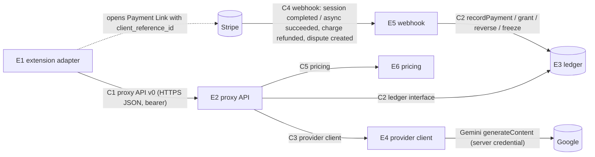

# Managed key — design spec (DRAFT, preparation only)

Status: draft for council and for Ted. Nothing here is authorized to launch. The hold in the
mission record stands: no account, no spend, no deploy, no store submission, no live key.
Author: LW-STORE lead (Claude Opus 5.5), 2026-11-28. Baseline: `main` 39b264a, extension 0.16.1.

## 1. Overview

Today every reader pastes their own Gemini API key ("BYOK"). The service worker sends up to
eight near-viewport passages straight to `generativelanguage.googleapis.com` with the key in
`x-goog-api-key` (`extension/src/gemini.js:24-29`, `extension/src/reading.js:231-275`). No
Lang Weave server exists, and the listing promise is "no account, progress stays in your
browser".

The managed key is an optional second path: the reader buys prepaid credit from Lang Weave,
and a small hosted proxy holds the provider credential, checks the reader's balance, makes the
model call, and debits the actual cost. BYOK stays the default and stays free with no feature
gated.

The point of this document is to decide whether that path is worth building, what the
smallest honest version is, and what has to be true before it takes a first dollar. Section 9
argues it is **not yet** worth launching: there are no outside users today.

## 2. Goals and non-goals

Goals, in priority order. A worker adjudicates a deviation against these.

1. **The reader can never be charged more than they prepaid.** Every model call is preceded by
   an atomic reservation of its worst-case cost against the reader's balance. No reservation,
   no call. There is no postpaid, subscription or auto-top-up path in v0.
2. **The operator's provider spend through the proxy is bounded per UTC day, by the ceiling.**
   Each call holds its largest possible provider cost (`providerMax`, C5) against the day's
   ceiling from reservation until its real cost is known. So the provider cost of all calls
   reserved on a UTC day never exceeds the ceiling, **provided C5's maximum is a true maximum**.
   That maximum covers every billable token class on the chosen route and is verified before any
   paid traffic (section 12, M2 condition). Two losses sit **outside** this bound and have their
   own controls: a leaked provider credential used directly against Google (section 7), and
   refunds or disputes (bounded per pack, C4).
3. **BYOK is untouched.** With the flag off (the default), the extension's network behaviour
   is identical to the same release built without the managed code: same hosts, same request
   bodies, same headers. Managed mode is a separate provider value,
   never a silent fallback in either direction.
4. **No reading content at rest, and pseudonymous accounts.** The proxy never writes page
   text, URLs, titles or model output to disk or to logs; the host platform's request-body
   logging is turned off. It stores an opaque account id, a hash of the bearer token, a balance,
   a ledger of (time, model, token counts, reader cost, provider cost, reason), and the Stripe
   Checkout session and customer ids needed for refunds. Those Stripe ids link an account to the
   purchaser's email inside Stripe, so the account is **pseudonymous, not anonymous**, and the
   privacy text says so. Client IP addresses are used only for the account-creation rate limit,
   held as a keyed hash that rotates daily, and dropped after 24 hours. A response held for an
   idempotent retry (C1) lives in memory for at most 60 seconds.
5. **Not an open model relay.** The proxy accepts only Lang Weave's structured swap inputs
   with bounded sizes, builds the prompt itself from the extension's own modules, and fixes
   the model allowlist, the response schema and the output cap. What this guarantees: the
   instructions are the server's, and the client fills only typed data slots (passages and
   validated word forms). It does **not** guarantee that the data slots are free of
   instruction-like text: a passage or a personal word can contain any prose, as in any reading
   app. The proxy checks the response shape before returning it (6.3); the extension still
   validates every swap.
6. **Testable without the network.** Every boundary has a stub: a stub provider, Stripe test
   fixtures with locally computed signatures, and an in-memory ledger.

Non-goals for v0: accounts with email or passwords; cross-device sync; subscriptions; free
trial credit; generated-language-pack creation and the key test through the proxy; Firefox;
any model other than the ones the extension already allowlists; analytics of any kind.

## 3. Firewalled entities

| Entity | Owns | Must not know |
|---|---|---|
| **E1 Extension managed-provider adapter** (`extension/src/managed.js`, flag-gated) | Token storage, sending the structured inputs `requestSwaps` already has, mapping proxy errors onto the existing `category` set, opening the Payment Link URL | The provider credential; any Stripe secret or API |
| **E2 Proxy API** (`proxy/src/api.js`) | Auth, request validation, building the request with the shared `buildSwapRequest`, reservation, calling E4, settlement, error mapping | Page text after the response returns; card data |
| **E3 Ledger** (`proxy/src/ledger.js`, storage interface) | Balances, reservations, settlements, credit grants, idempotency of grants | Request content |
| **E4 Provider client** (`proxy/src/provider.js`) | The one outbound model call, timeout, reading `usageMetadata` | Accounts, balances |
| **E5 Stripe webhook** (`proxy/src/stripe.js`) | Signature verification, turning a paid Checkout session into exactly one credit grant | Request content |
| **E6 Pricing table** (`proxy/src/pricing.js`) | Per-model prices, markup, worst-case reservation formula | Everything else |

E2 depends on E3, E4, E6 only through their published interfaces, so each can be replaced by a
stub in tests.

## 4. Boundary diagram



## 5. Contracts

### C1 — Proxy API v0 (owner E2; consumer E1)

All requests are HTTPS, JSON, `Content-Type: application/json`, at most 192 KiB (larger is
`413` with `"tooLarge": "body"`, no reservation). Responses never
echo request text. Every error body is `{"error": {"category": <string>, "retryAfterMs"?: <int>,
"ahead"?: <bool>, "duplicate"?: <bool>, "charged"?: <bool>, "keyReuse"?: <bool>,
"blocked"?: <bool>, "tooLarge"?: "body"|"passages"|"words", "dailyCap"?: <bool>}}`,
with `category` drawn from the extension's existing set in `quota-status.js` plus four new
values, which E1 adds to `STATUS_CATEGORIES` (`quota-status.js:9`) and to the message mapping in
`reading.js`: `managed_balance`, `managed_unauthorized`, `managed_unavailable`,
`managed_update_required`. A 200 body's `usage` is `null` when the provider sent none (6.3).

CORS, not a manifest change: the proxy answers with `Access-Control-Allow-Origin:
chrome-extension://lkbkmlgogcpcacjmdmoecgacdbfddbnh` and allows the `Authorization`,
`Content-Type` and `Idempotency-Key` headers, so the service worker can call it without a new host
permission. The allowed origins are every extension ID that ships (the unpacked beta ID above,
and the Store item's ID once DECISIONS D1 step 3 establishes it). The manifest does not change
with the flag: a boundary test compares the flag-on and flag-off builds of the same release byte
for byte.

- `POST /v0/accounts` → `201 {"accountId": "acct_<26 base32>", "token": "lwk_<43 base64url>"}`.
  No body. The token is 256 random bits, returned exactly once; the proxy stores only
  `SHA-256(token)`. Rate limit: 5 per IP per hour (`429 rate_limit`). A new account has balance 0.
- `GET /v0/balance` with `Authorization: Bearer <token>` → `200 {"balanceMicros": <int>,
  "reservedMicros": <int>}`. Unknown token → `401 managed_unauthorized`.
- `POST /v0/swaps` with bearer token and a **structured** body; the proxy builds the prompt
  itself (6.2):
  ```json
  {"promptVersion": "0.16", "model": "gemini-3.5-flash-lite", "level": 1, "language": "es",
   "density": "normal", "gradual": true,
   "words": [{"source": "bundled", "fr": "ventana", "en": "window", "status": "active"}],
   "shownToday": ["ventana"],
   "passages": [{"id": "p1", "text": "..."}]}
  ```
  → `200 {"text": <candidate text>, "usage": {"promptTokens", "outputTokens", "thoughtTokens"},
  "costMicros": <int>, "balanceMicros": <int>}`.
  The request carries an `Idempotency-Key` header (a random 128-bit value per logical batch).
  Validation, all before any reservation: `promptVersion` is one the deployed proxy carries
  (otherwise `409 managed_update_required`); model in the allowlist; `level` 1 or 2;
  `language` is a code the proxy's language table knows; `density` one of the three values;
  `gradual` a boolean; at most 8 passages, each `id` at most 64 characters and `text` at most
  2,000 characters (the extension's own batch caps, `reading.js:97-98`); at most 400 words and
  400 `shownToday` forms. **Each word carries its provenance, `source`: `bundled`, `pack` or
  `personal`, and is checked with that class's own rules from the extension, not a new regex:**
  bundled Spanish and Guaraní rows must match a row of the catalog the proxy carries;
  pack words must pass the pack cleaner's own rules (`validPackForm`, `word-form.js:5-6`, form at
  most 50 UTF-16 units; gloss through `validField`, `languages.js:13`, at most 60 characters);
  personal words must pass `validForm` (`personal.js:18`, at most 80 code points); `status` comes
  from the extension's status set. A boundary test feeds every bundled row in both languages,
  plus pack and personal fixtures at each class's maximum length, through this validation and
  requires all to pass.
  The proxy then calls `buildSwapRequest(inputs)`, a pure function extracted in M1 from
  `requestSwaps` (`engine.js:14-20`) so that **both** paths use it: it applies
  `possibleSpanishPromptWords` to ordinary Spanish, computes `unknownBudget(passages)` when
  `gradual` is true, and calls `buildSystemPrompt`, `buildUserContent` and `buildRequest` with
  `RESPONSE_SCHEMA`. A golden test requires the proxy-built body to equal the BYOK body for the same
  inputs, and the module closure must load with no `chrome` global. The proxy then sets
  `generationConfig.maxOutputTokens`. **Size cap: the same measure and the same limit the
  extension already uses**, `requestChars` (`adaptive.js:40-47`, the length of the serialized
  body) at most `MAX_REQUEST_CHARS` = 25,000 (`adaptive.js:10`); `requestChars` counts UTF-16 code
  units, each at most 3 UTF-8 bytes, so the UTF-8 body is at most 75,000 bytes; the cost bounds
  use 100,000 as a deliberately loose upper figure, and no validator should be tightened to it. Over the cap → `400 request_failed` with `"tooLarge": "passages"` when the batch has more
  than one passage, or `"tooLarge": "words"` when a single passage is still over. E1 checks the
  same measure **before** sending, so a conforming client never gets either: it splits the
  passages until each request fits (down to one passage), and for a single passage still over,
  it drops that passage from managed weaving with `request_failed` and no call. A `400` costs
  nothing because it never reserves. E1 only splits on `tooLarge`, never on other `400`s. Other
  violations → `400 request_failed` with no provider call. A boundary test builds the combined
  maximum (eight 2,000-character passages, the largest pack of 80 words at their field maxima,
  and a personal-word list at its maxima) and asserts, for that fixture, exactly which passages E1
  sends, in how many requests, which (if any) it drops, and that every emitted request is under
  the cap and accepted by the proxy. A test that passes because everything was dropped fails.
  Idempotency: `reserve` claims `(accountId, SHA-256(Idempotency-Key))` together with
  `SHA-256` of the canonical request body **in the same transaction** as the reservation (C2), so
  a crash cannot leave a charged call without its key. The claim is kept for 60 seconds after
  settlement and holds no reading content. A repeat within that window makes no new reservation
  or provider call: with the same canonical body it returns the held response if the serving instance
  still holds it in memory, otherwise `409 request_failed` with `"duplicate": true` and
  `"charged": <bool>` from the recorded outcome; with a different body it returns
  `422 request_failed` with `"keyReuse": true`. A repeat while the original is still open returns
  `429 rate_limit` with `retryAfterMs`. After 60 seconds a repeat is a new call. **Key lifetime in
  E1:** a key identifies one **canonical body**: the structured request serialized by the one
  canonicalizer both sides import (sorted keys, no insignificant whitespace), the same bytes the
  proxy hashes. E1 reuses a key only when it would send byte-identical canonical bytes within 60
  seconds (for example after the page re-renders an unchanged batch), so a re-request of an
  abandoned call returns `duplicate` instead of a second charge. Any change (passage text,
  `shownToday`, density, words) gets a new key. If E1 nevertheless receives `keyReuse`, it mints a
  new key and sends once more.
  Errors: `402 managed_balance` when the reservation fails; `503 managed_unavailable` when the
  global ceiling is reached or the proxy is in maintenance; provider 429/503/timeout map to the
  existing `rate_limit` / `overloaded` / `request_failed` with `retryAfterMs` passed through
  when bounded.
- **Invariants:** a 200 or a provider error is always preceded by exactly one successful
  reservation and followed by exactly one settlement or release. A 4xx from validation, auth or
  balance never calls the provider. `costMicros` on a 200 is at most the reservation. At most
  one reservation per account and at most `IN_FLIGHT_MAX` (v0: 4) reservations overall are open
  at once; a call over either limit gets `429 rate_limit` with no provider call. A frozen account
  (C4) gets `402 managed_balance`.
- **Fixed constants (part of the contract, so tests can pin them):** `maxOutputTokens` 2,048;
  E1's request timeout 30 s; provider timeout = E1's timeout − 10 s = 20 s (a dependent
  constant: the 10 s margin covers cold start, reservation and settlement, so the extension normally
  does not abandon a call it will be charged for. It is not a guarantee: a slow network can still
  cost the reader a call whose result never arrives, and a retry within 60 s then gets
  `"duplicate": true` rather than a second charge); `IN_FLIGHT_MAX` 4; per-account daily
  cap `ACCOUNT_DAILY_PROVIDER_MAX` (v0: $1.00 of provider cost) so one account or stolen token
  cannot exhaust the global ceiling. Because admission needs room for the next call's
  `providerMax` (about $0.17 for a typical request with the placeholder overage), an account is
  admitted until about $0.83 of settled provider cost, roughly 260 typical calls a day; a call
  refused by this cap gets `402 managed_balance` with `"dailyCap": true`; stale-reservation expiry 5 minutes;
  day key is the UTC date of the proxy's clock **at reservation time**.
- **E1 behaviour in managed mode:** one model only (the allowlisted one, whatever
  `settings.model` says); no `FALLBACK_MODEL` and no client cooldown retry, because every retry
  could be a second charge; the existing local daily call cap still applies. E1 sends the 0.16.x
  structured inputs it already has; it never sends a system instruction.
- **Intentionally unspecified:** latency, the markup, which provider
  route the proxy uses. Consumers must not parse `text` beyond `parseSwapsResponse`.
- **Versioning:** the path prefix carries the version. Adding an optional response field is
  compatible; anything else is `/v1`.

### C2 — Ledger interface (owner E3; consumers E2, E5)

Amounts are integer **micro-dollars** (1 USD = 1,000,000). No floats anywhere in money.

Two amounts travel together: **reader micros** (retail, with markup, debited from the balance)
and **provider micros** (Google's list cost, counted against the daily ceiling). Every operation
below is one transaction, and Stripe event deduplication happens in the same transaction as the
ledger change it causes.

Invariant, checked after every operation: **`balance >= reserved >= 0`** for every account.

- `createAccount(tokenHash) → accountId`
- `reserve(accountId, readerWorst, providerMax, dayKey, ceiling, keyHash, bodyHash) →
  reservationId | BALANCE | DAILY_CAP | CEILING | BUSY | FROZEN | DUPLICATE | KEY_REUSE`, which also
  claims the idempotency key (C1) in the same transaction, where `providerMax = providerWorst + maxPerCallOverage` (C5) is the
  largest amount the call could possibly cost the operator. It succeeds only if: the account is
  not frozen; it has no open reservation; `balance - reserved >= readerWorst`; fewer than
  `IN_FLIGHT_MAX` reservations are open; the account's day `providerSpent + providerHeld +
  providerMax <= ACCOUNT_DAILY_PROVIDER_MAX`; and the global day `providerSpent + providerHeld +
  providerMax <= ceiling`. The reservation records its `dayKey`; everything about it is accounted
  to **that** day (the UTC date at reservation), whatever date the provider's invoice uses.
- `settle(reservationId, readerActual, providerActual, reason)` — compare-and-set on state
  `open`: the first of `settle`, `release` or `expireStale` wins; the others are no-ops that return
  the winner's result. The reader is charged `min(readerActual, readerWorst)`. The day's
  `providerHeld` drops by `providerMax` and `providerSpent` rises by the **full**
  `providerActual`, which includes input, output and thinking tokens. A `providerActual` above
  `providerMax` means C5's maximum is wrong: it raises an `overage` alarm, which stops all managed
  calls (section 12), and the full amount stays recorded. The **reader debit and the provider
  accounting are independent**: the reader is always charged the 6.3 table's reader amount for
  the outcome, capped at `readerWorst`, whatever the provider state. For an **unknown-cost
  outcome** (6.3) the provider side moves to state `provisional`: the full `providerMax` stays
  counted for the day and waits for reconciliation. A provisional hold that is never reconciled
  stays counted for its own day only; the next UTC day starts with no holds from earlier days.
- `reconcile(reservationId, providerActual)` — once, for a `provisional` row, and only when the
  cost can be attributed to **that** reservation: a late response for its own request, or a
  provider usage-export row matched by its request id. It replaces the provisional `providerMax`
  with the full confirmed `providerActual` for the original day; if that is above `providerMax`,
  it raises the same `overage` alarm and stop as `settle`. Unattributable costs never lower a
  hold. The reader is not charged again or refunded automatically.
- `release(reservationId)` — releases the whole reservation. Same compare-and-set.
- **Payment record**, keyed by Stripe `payment_intent` (refund and dispute events carry it;
  Checkout session events carry both it and the session id): `{paymentIntentId,
  checkoutSessionId?, accountId?, packMicros, grantState: pending | granted | refused,
  reversalTarget, reversedMicros, disputed}`. `recordPayment(...)` creates or updates it from any
  of the four events, so the order in which events arrive does not matter. When a Checkout event
  that passed C4's link and amount checks supplies the `accountId` for a record that is already
  disputed, the account is frozen at that moment.
- `grant(paymentIntentId)` — from `pending` only: adds `packMicros - reversalTarget` and moves to
  `granted`, if the payment is not disputed, the account exists and is not frozen, and the
  account's balance is below one pack (so an account holds at most two packs' credit at once).
  Otherwise it moves to `refused`, recorded as an orphan for the operator to refund. From
  `granted` or `refused` it is a no-op, so a second payment notification never turns a
  successful purchase into an orphan.
- `reverse(paymentIntentId, target)` — for refunds and disputes. `target` is the **cumulative**
  credit that should be reversed, in ledger micro-dollars: `ceil(packMicros × amount_refunded /
  amount_paid)` for a refund event, `packMicros` for a dispute. The record keeps `reversalTarget =
  max(reversalTarget, min(target, packMicros))`, so it is monotonic and never negative, whatever
  order events arrive in or however refunds and disputes overlap. For a `granted` payment it then
  debits only the increase, at most `balance - reserved` of the account currently holding the
  payment (below); any remainder is operator loss and freezes that account. For a `pending`
  payment it only records the target, which the later grant subtracts.
- `freeze(accountId, reason)` — no new reservations. An open reservation settles normally.
- `adjust(accountId, deltaMicros, reason, ref)` — an operator credit or debit for corrections
  that are **not** Stripe refunds. A debit takes at most `balance - reserved`. Unique per `ref`.
  A refund on request is always issued in Stripe and reaches the ledger only through the
  `charge.refunded` webhook, so it can never be debited twice.
- `transfer(fromAccountId, toAccountId, ref)` — token recovery in one step. Refused if `from` is
  frozen (a frozen account's balance stays put until the operator resolves the dispute or
  refund), if `to` is frozen, or if `from` has an open reservation. Otherwise it moves `balance`
  from `from` to `to`, **reassigns `from`'s payment records to `to`** (so later refunds, disputes
  and freezes apply to the account now holding the credit), revokes `from`'s token, and freezes
  `from`. A payment record's `accountId` is set once, by the first Checkout event that passes C4's
  checks, and afterwards changes only through `transfer`; a later Checkout notification carrying
  the original account id does not move it back. `grant`'s one-pack rule does not apply to a
  transfer, which may leave `to` holding more than two packs. Unique per `ref`.
- `revokeToken(tokenHash)` and `rotateToken(accountId) → newToken` — take effect for the next
  reservation; an open reservation settles normally.
- `expireStale(now)` — a reservation open longer than 5 minutes (well past the provider timeout)
  becomes an unknown-cost outcome with reason `timeout` (state `provisional`).

### C3 — Provider client (owner E4; consumer E2)

`call({model, request, timeoutMs}) → ProviderOutcome`, one of:

- Every outcome carries `providerRequestId` when the route supplies one (for example a response
  id or request-id header); E2 stores it on the reservation so `reconcile` can match a provider
  usage-export row to it. `no_response` usually has none; such a hold is reconciled only by a
  late response or not at all, and is then released with its day (C2).
- `{kind: "ok", text, finishReason, blockReason, usage}`: HTTP 200. `finishReason` from the first
  candidate (or `null` when there is none); `blockReason` from `promptFeedback.blockReason` (or
  `null`); `usage` from `usageMetadata` (`promptTokenCount`, `candidatesTokenCount`,
  `thoughtsTokenCount`) or `null` when absent.
- `{kind: "http_error", status, category, retryAfterMs}`: the provider answered non-200.
- `{kind: "no_response", sent: true}`: the request was handed to the network and no complete
  response arrived (timeout, reset). `sent: false` (DNS or connect failure before any byte was
  written) is reported as `http_error` with category `request_failed` and is never billed.

The server credential is read from the environment at start; it is never logged, never put in
an error, and never returned. E2 maps each outcome to a charge with the ordered table in 6.3. The
table is per route: the one in 6.3 comes from the AI Studio billing FAQ. The Vertex route says only
that it charges "for requests that return a 200"; its table must be derived and tested before M2,
and until then the Vertex provider client counts every `ok` outcome as fully billed to the
ceiling, while the reader is still charged only as the 6.3 table says.

### C4 — Stripe webhook (owner E5; producer Stripe)

`POST /v0/stripe/webhook`. The raw body is verified against `Stripe-Signature` with the endpoint
secret and a 300-second tolerance before it is parsed; a bad or stale signature is `400` and
changes nothing.

Every handled event first calls `recordPayment` (C2) for its `payment_intent`, in the same
transaction as the event-id deduplication and any ledger change, so events may arrive in any
order and any number of times.

- **Grant.** `checkout.session.completed` or `checkout.session.async_payment_succeeded`, with
  `mode: "payment"` and `payment_status: "paid"`, calls `grant` if **all** of these hold:
  `payment_link` is the one configured link; `currency` is `usd`; `amount_total` equals that
  link's configured price exactly (so a discount, a changed price or a misconfigured link grants
  nothing and is logged for the operator); `client_reference_id` matches `^acct_[A-Z2-7]{26}$`.
  The pack size comes from the proxy's own table for that link, never from the event. `grant`
  itself applies the remaining checks (account exists and is unfrozen, payment not disputed,
  balance below one pack) and subtracts any reversal that arrived first. A completed session
  with `payment_status` other than `paid` grants nothing; its later `async_payment_succeeded`
  event grants once. v0 configures the link for card payments only, so the asynchronous case
  should not occur, but it is handled.
- **Refund.** `charge.refunded` calls `reverse` with the cumulative target from the event's
  `amount_refunded` (C2). Stale or out-of-order refund events lower nothing. If the payment was
  not yet granted, the later grant is reduced or, for a full refund, becomes zero.
- **Dispute.** `charge.dispute.created` marks the payment disputed, calls `reverse` with target
  `packMicros`, and freezes the account holding the payment (or, if no Checkout event has
  arrived yet, freezes it when one does, C2). A not-yet-granted disputed payment never grants.
  Unfreezing is a manual operator action after the dispute closes. A dispute on an already
  refunded payment reverses only the remaining difference.
- **Orphan payment.** A paid session whose `client_reference_id` is missing (someone opened the
  bare link), malformed or unknown, or whose grant `grant` refuses, returns 200 (so Stripe stops
  retrying), grants nothing, and is recorded as an orphan for the operator to refund.
- The Payment Link is configured with a fixed quantity of one, no promotion codes and cards only;
  the amount check above catches a link changed later. A reusable link still allows several
  purchases by one account; `grant`'s one-pack rule limits how much credit one account holds.
- Every other event type returns 200 and changes nothing.

Disputes can arrive weeks after purchase, so freezing does not stop disputes on packs already
spent. The commercial bound is therefore **per disputed pack**: at most its price plus the $15
dispute fee. It is not a per-account or per-day bound. What limits the rate is that an account
holds at most two packs' credit at once and spends at most `ACCOUNT_DAILY_PROVIDER_MAX` of
provider cost a day, and Stripe Radar sees a repeated card.

### C5 — Pricing (owner E6; consumer E2)

`worst(model, requestBytes, maxOutputTokens) → {readerMicros, providerMicros}` and
`actual(model, outcome) → {readerMicros, providerMicros}`, both rounding **up** to the next
micro-dollar. Reader micros include the markup; provider micros do not.

- **Input bound:** the number of UTF-8 bytes of the full serialized request body, including
  `responseSchema` and the system instruction. A tokenizer with
  byte fallback never produces more tokens than bytes [assumption about Google's tokenizer, to be
  checked against `countTokens` in M1]. This is far above the real count (about four bytes per
  token) and still small: the 100,000-byte maximum body (C1) costs at most $0.030 at $0.30 per
  million.
- **Output bound:** `maxOutputTokens`. Whether that cap also bounds thinking tokens on 3.5
  Flash-Lite is **unverified**, so the reservation does not rely on it for the operator bound:
  the per-call overage a reservation can miss is limited by the model's maximum output length.
  `maxPerCallOverage = (modelMaxOutputTokens − maxOutputTokens) × output price`, a table value.
  Until M1 reads `modelMaxOutputTokens` from the model card, the table uses 65,536 [placeholder,
  unverified], which makes `maxPerCallOverage` about $0.16 and `providerMax` between about $0.17
  (a typical 8 KB request) and $0.19 (the 100,000-byte maximum). It is held only while a call is
  open or unreconciled, so four calls in flight hold at most about $0.78 of a $2 ceiling; about a dozen unreconciled timeouts in a day stop managed reading for everyone until
  midnight UTC, which is the safe failure.
- **Condition for paid traffic:** `providerMax` must be a verified maximum for the chosen route
  covering **every** billable token class (input, cached input, output, thinking, and any other
  class the route bills) at the effective price for the call's date. The input bound rests on a
  tokenizer assumption and the output bound on a model-card figure; both must be confirmed from
  the provider's documentation (not by sampling `countTokens`, which cannot prove a maximum) before
  M2. Until then the bound in goal 2 is conditional and the spec says so.
- **Freshness:** the table is data with a `checkedOn` date and the price source URL. A test fails
  when `checkedOn` is older than 30 days, and the table carries announced future prices with their
  effective dates (3.8 Flash doubles on 2027-01-01), selecting by the call's date. The test is
  meant to fail on the calendar alone: the fix is to re-read the price page and update the
  price and `checkedOn` together, never to bump the date.

## 6. Design choices and why

### 6.1 Prepaid credits, not a subscription

Recommendation: **prepaid credit packs through a Stripe Payment Link**, starting with one $10
pack (section 10.5 explains why not $5).

- A balance is the hard per-reader bound in goal 1. A subscription still needs a usage cap,
  plus proration, renewal failure, cancellation and dunning: more code and more support.
- Usage varies by two orders of magnitude between readers (an hour of X scrolling is 40–60
  calls, a long article about 4; the local cap is 1,000 calls a day: `quota.js:4`). A flat
  subscription either loses money on heavy readers or overcharges light ones.
- A Payment Link takes `client_reference_id` as a URL parameter, so the proxy never creates a
  Checkout session and never talks to Stripe outside the webhook. Stripe hosts the card page;
  Lang Weave never sees card data.
- Unspent credit is a liability and may be refundable on request; v0 says so plainly and does
  not expire credit.

### 6.2 Server-built prompt, not a pass-through

The proxy takes Lang Weave's structured inputs and builds the prompt itself, with the same
modules the extension ships. It never runs a client-supplied system instruction.

Two reasons. First, the contract: the Google APIs Terms forbid creating "an API Client that
functions substantially the same as the APIs and offer[ing] it for use by third parties"
(Google APIs Terms 4(a), quoted in section 10.1). An endpoint that runs any client-supplied system prompt under a fixed schema is
uncomfortably close to that line; an endpoint that only turns passages and a word list into
swaps reads much more clearly as an application (the brief marks this as inference, and section
13 keeps it as an open question). Second, abuse: with the prompt fixed, the only free text is
the passage itself, which is exactly the content any reading app must accept.

The version-skew cost is handled by `promptVersion`. The proxy is deployed from a release
commit. It imports the current prompt modules from `extension/src/` and carries the previous
release's in a vendored snapshot, `proxy/prompts/<version>/`, generated by a script and checked
by a test that the snapshot equals that release tag's files. An extension ahead of the proxy gets
`409 managed_update_required` with `"ahead": true` and sees "Managed reading is updating; try
again later". An extension older than both gets `"ahead": false` and sees "Update Lang Weave to
keep using managed reading". BYOK readers are unaffected. The extension still
validates every swap (`engine.js:37-40`).

### 6.3 Metering by outcome, not by `usageMetadata` alone

Google's billing FAQ says HTTP 4xx and 5xx responses are not billed, and that an HTTP 200
with `finishReason: SAFETY` bills input but not output. It also warns that `usageMetadata`
can carry `promptTokenCount` on a 200 whose input was not charged. So settlement keys on the
outcome:

Settlement is decided in two steps. **First the billing class**, from the outcome alone (rows
are checked in order; the first match wins). **Then the amount**: when `usage` is present it is
priced as the class says; when `usage` is missing, the reader is charged the class's own worst case
(never more than the class bills) and the provider amount is held at `providerMax`, provisional.
"Provider" is what is counted against the day's ceiling (C2); it always includes thinking tokens.

| # | Outcome (C3) → class | Reader charged | Provider counted | API response (C1) |
|---|---|---|---|---|
| 1 | Validation, auth, balance, cap, ceiling, busy or frozen | nothing; no reservation | nothing | the matching 4xx/503 |
| 2 | `http_error` (any non-200), or failure before sending | nothing; released | nothing | mapped error, `retryAfterMs` if bounded |
| 3 | `no_response`, `sent: true` | `readerWorst`, reason `timeout` | `providerMax`, provisional | `504 request_failed` |
| 4 | `ok`, `blockReason` set (prompt blocked, no candidate) | nothing | `providerMax`, provisional (the FAQ does not settle whether this input is billed) | `502 request_failed`, `"blocked": true` |
| 5 | `ok`, `finishReason` `SAFETY` | input only (the FAQ: input billed, output not); without `usage`, the input worst case | input from `usage`; without it, `providerMax`, provisional | `502 request_failed`, `"blocked": true` |
| 6 | `ok`, any `finishReason` other than `STOP`, `MAX_TOKENS` or `SAFETY` (`RECITATION`, `PROHIBITED_CONTENT`, `BLOCKLIST`, `SPII`, `OTHER`, unknown) | nothing, reason `unclassified`, flagged for review | `providerMax`, provisional, until the route's table classifies it | `502 request_failed`, `"blocked": true` |
| 7 | `ok`, `finishReason` `MAX_TOKENS` | input + output + thinking, at most `readerWorst`; counted and alerted on | full cost from `usage`; without it, `providerMax`, provisional | `502 request_failed` (the JSON is truncated and fails the shape check below) |
| 8 | `ok`, `finishReason` `STOP` | input + output + thinking from `usage`, at most `readerWorst`; without `usage`, `readerWorst`, reason `no_usage` | full cost from `usage`; without it, `providerMax`, provisional | 200, `usage` as received or `null` |

Before a 200 is returned (row 8), the proxy checks that `text` parses as JSON matching
`RESPONSE_SCHEMA` and that every passage `id` in it was in the request; a failure turns it into
`502 request_failed` with the same charge. The full swap validation stays in the extension
(`validateSwaps`), because only the extension holds the page context.

The rule is: charge the reader only for classes the billing FAQ says are billed, and count against
the ceiling anything that might be. Row 3, and rows 5, 7 and 8 without `usage`, charge the reader for a call Google may have
billed, because charging zero would let a retry loop spend without limit. The per-call worst case
is about seven cents to the reader at the 2× markup (section 10.4), and about two cents for a
typical request, whose reservation is computed from its own size. In managed mode E1 makes no
automatic retries (C1), the per-account limit of one open reservation stops parallel retries, the
local daily call cap still applies, and the ledger shows the reason.

### 6.4 Bearer token, no email held by Lang Weave

The token is the account. It is stored exactly like today's API key: in `chrome.storage.local`
with the `TRUSTED_CONTEXTS` access level (`background.js:58-63`), out of content scripts' reach. Two
existing key rules extend to it. Backups exclude it (`portability.js:42,51` list `apiKey` as
non-learning; the token is added beside it), and import into a profile that holds a token is
refused like a profile with a key (`portability.js:556`). When key isolation is unavailable, the
API key falls back into `settings` (`background.js:61-75`); the managed token never does: managed
mode refuses to turn on and says why.

A lost token loses the balance unless the reader recovers it. Recovery needs **two** things: the
Stripe receipt, and the account id that Settings shows and the reader can copy (the account id is
not a credential; the token is). A forwarded receipt alone is not enough. The operator then moves
the balance to a new account with `adjust` and records both references. This keeps "no login and
no email held by Lang Weave" true, while being honest that Stripe holds the purchaser's email and
card details under Stripe's own terms.

## 7. Abuse and key-leak risks

| Risk | Effect | v0 control | Residual |
|---|---|---|---|
| Provider credential leaks from the proxy | Spend on the operator's account outside the proxy, so the ceiling does not apply | Prefer short-lived credentials (workload identity) over a stored key; credential only in the host's secret store; never logged; least-privilege role; provider-side budget alert; rotate on any suspicion | **Route-dependent.** On AI Studio the billing-tier cap pauses the account at its limit. On Vertex no hard provider-side spend stop was found tonight (budget alerts only notify); a project quota limit, if the console offers one, is the only hard stop, and that must be checked before M2. Until then this loss is bounded only by detection and rotation time. |
| Reader's bearer token stolen (malware, synced profile, shared machine) | Thief spends that reader's balance | Balance and the per-account daily cap are the bound; `revokeToken`/`rotateToken` (C2) | Same exposure class as today's BYOK key, but bounded by a prepaid balance instead of the key's quota |
| Proxy used as a cheap general LLM, or read by Google as resold API access | Content-policy and contract exposure for the operator | Server-built prompt; only passages and validated word forms are free input; fixed schema, model allowlist, size caps, output cap, prepaid only | Instructions inside passage text can still steer string fields. Bounded by balance and the cap, and the same as any reading app. |
| One project's provider quota and spend cap | All managed readers pause together; on AI Studio Tier 1 the billing account pauses at $250 a month | Global daily ceiling well under the tier cap; one project, honest quota-increase requests (splitting projects to multiply quota is circumvention under both contracts) | A busy day returns `managed_unavailable` to everyone |
| Card testing on the Payment Link | Stripe fees, disputes | Stripe Radar defaults; one fixed-price pack; no free credit | Dispute fees per incident |
| Chargeback after spending | Loss of up to one pack plus the $15 fee, per disputed pack | At most two packs held at once; per-account daily cap; freeze on dispute | Accepted |
| Sybil accounts | Ledger rows | Accounts start at zero; per-IP rate limit on creation | Harmless rows; periodic deletion of zero-balance accounts older than 30 days |
| Prompt injection from page text | Bad swaps | Response schema plus existing client validation (`validateSwaps`) | Unchanged from BYOK |
| Replay or reordering of Stripe events | Double credit, or credit after a refund | Event-id deduplication in the same transaction as the ledger change; one grant per `payment_intent`; monotonic reversal target | None known |
| Clock or retry races in reservation | Overspend | One transaction per reservation; settlement clamps | Covered by boundary tests |

## 8. Privacy, store and provider implications

**Privacy promise changes.** Today: "no Lang Weave server sees your reading". In managed mode,
the proxy receives passage text in transit. The policy and listing must say so in plain words
and must keep the BYOK statement intact for BYOK readers. Managed calls go through a billed
provider account, which changes the Google data-use terms that apply to the passage text
(section 10 quotes them). The store data disclosure gains "website content transmitted to the
developer's server", "authentication information" (the token) and "financial and payment
information: processed by Stripe, not collected by Lang Weave". Limited Use must be restated.

**In-extension payment.** The Chrome Web Store appears to offer no payments of its own any more
[inference: the old payments page returns 404 and no current page documents one]; an extension
may send readers to an external payment page, and the listing must disclose paid features.
Section 10 quotes the current policy text and the publisher-identity requirements that start
when an item offers paid features.

**Provider terms.** Section 10. In short, whether an AI Studio key may back a consumer product
sold by Lang Weave is the decision that gates everything else.

## 9. Demand: be sceptical

There are no known outside users. The scout run on the night of 2026-11-28 found none; every install observed in
the mission record is the owner's fleet. The category record is poor: Toucan sold to Babbel and
stopped shipping, Lingua.ly closed, and a published freemium-extension report shows about 0.8%
of all users converting (`docs/research/market.md`, "Monetization"). At 0.8%, covering even a
$5/month fixed hosting bill at the $4.41 margin per $10 pack (section 10.5) needs a few hundred active readers.

Evidence that would change this, in the order it could arrive:

1. A free BYOK listing exists and the Store dashboard shows **at least 200 weekly users for four
   consecutive weeks**. Until then the managed path has nobody to sell to.
2. **At least 20 distinct readers** take an explicit "I'd rather pay than get a key" action: a
   link on the key step to a static page with a GitHub discussion or a mailto. It is counted by
   hand, not by telemetry.
3. Of the readers who reach the key step, **more than half abandon it** (visible as Store users
   without a key, which only a reader can tell us: ask in the discussion). That would mean the
   key is the bottleneck the managed path removes.

If (1) never happens, the managed path does not matter. If (1) happens without (2) or (3), the
cheaper fix is a better key flow, not a server.

## 10. Provider terms, pricing and unit economics

Full quotes, URLs and dates are in `docs/research/managed-key-terms-2026-11-28.md`, fetched on
the night of 2026-11-28. This section gives the governing clauses and what they mean for the
design. None of it is legal advice; section 13 lists what only a lawyer or Google can answer.

### 10.1 What the provider terms allow

**No published clause requires a separate written agreement with Google** for a server that
holds a Gemini credential and serves Lang Weave's own readers, on either route below. Both
routes forbid reselling the model itself. Which side of that line Lang Weave sits on depends
on the proxy's shape, which is why 6.2 builds the prompt on the server.

- **Google APIs Terms of Service** (last modified 2021-11-09), section 4(a): you may not
  "Sublicense an API for use by a third party. Consequently, you will not create an API Client
  that functions substantially the same as the APIs and offer it for use by third parties."
  Section 3(a): "The APIs are designed to help you enhance your websites and applications
  ('API Client(s)')." <https://developers.google.com/terms>
- **Gemini API Additional Terms** (effective 2026-03-23), Use Restrictions: "Use of Google AI
  Studio and Gemini API is for developers building with Google AI models for professional or
  business purposes, not for consumer use." and "You may use only Paid Services when making API
  Clients available to users in the European Economic Area, Switzerland, or the United
  Kingdom." Age Requirements: "You must be 18 years of age or older to use the APIs. You also
  will not use the Services as part of a website, application, or other service ... that is
  directed towards or is likely to be accessed by individuals under the age of 18."
  <https://ai.google.dev/gemini-api/terms> (now served at aistudio.google.com/docs/terms)
- **Paid vs unpaid data use**, same terms: on Unpaid Services Google uses submitted content "to
  provide, improve, and develop Google products" and "human reviewers may read, annotate, and
  process your API input and output"; on Paid Services Google "doesn't use your prompts ... or
  responses to improve our products" but "logs prompts and responses for a limited period of
  time, solely for detecting and preventing violations of the Prohibited Use Policy". A managed
  key is always a paid project, so a managed reader's passages get the paid-tier treatment, which
  is **better** than what a free-key BYOK reader gets today. On the recommended Vertex route the
  governing text is instead the Google Cloud Service Specific Terms (section 20.h of the
  generative AI terms, which the brief summarizes as keeping prompts and output inside the
  customer's account). Whether Vertex also logs prompts for abuse monitoring, and for how long,
  was not checked tonight and must be read before the privacy text is written.
- **Google Cloud Terms of Service** (Vertex AI route, last modified 2026-11-18), 1.1: Customer
  "may use the Services, and integrate the GCP Services ... into any Customer Application that
  has material value independent of the Services". 3.3: Customer will not "(c) sell, resell,
  sublicense, transfer, or distribute any or all of the Services" or use them "in a manner
  intended to ... circumvent Service-specific usage limits or quotas", including "creating
  multiple ... Projects to simulate or act as a single ... Project".
  <https://cloud.google.com/terms>

Reading: the AI Studio route works but carries the unresolved "not for consumer use" sentence
and account-wide spend-cap pauses ($250 a month on Tier 1, per the rate-limits page). The
Vertex route has an express permission for exactly this ("Customer Application that has
material value independent of the Services"), defined End Users and no consumer-use sentence;
its global endpoint costs the same as AI Studio. **Recommendation: Vertex AI global endpoint for
a real managed key.** The 18+ clause applies to both routes and to BYOK already.

Earlier research reached the same line. `docs/research/sync-service.md` ("Provider resale")
proposed a `/v1/weave` endpoint that "only performs Lang Weave's own prompt and returns validated
swaps" as the product shape and called a general model proxy "the resale shape". It also quotes
OpenAI's and Anthropic's commercial terms, both of which allow a product for end users and forbid
reselling raw access. If paid progress sync (Ted's 2026-11-02 direction, ditz
`hosted-tier-and-donations-ruling`) is ever built, the managed key's ledger and auth can live on
the same server; this spec keeps them separate so either can ship alone. The open ruling ditz
`hosted-weave-privacy-terms-ruling` is the one this spec asks Ted to decide (DECISIONS D6, D7).

### 10.2 The alternative that holds no money

OpenRouter's OAuth PKCE flow gives each reader a key tied to their own OpenRouter account, with a
credit limit they control; "Their requests are billed to their own OpenRouter credits, so you
don't pay for their inference or manage keys on their behalf"
(<https://openrouter.ai/docs/guides/overview/auth/oauth>). It serves `gemini-3.5-flash-lite` at
Google's list price. Lang Weave would hold no key, no money, no ledger and no stored value, and
needs no Stripe account, trader status or physical address. Its costs: a second provider client
in the extension, an OpenRouter account and card for each reader, and OpenRouter's terms, which
make unused credit non-refundable after 24 hours. It removes the key-setup friction without
making Lang Weave a seller. **If the problem to solve is key friction rather than revenue, this
is the better first step**, and DECISIONS.md asks Ted which problem he means.

### 10.3 Prices (Gemini Developer API, paid Standard tier, read 2026-11-28; the page carries no date)

| Model | Input / 1M | Output incl. thinking / 1M |
|---|---|---|
| gemini-3.5-flash-lite (extension default) | $0.30 | $2.50 |
| gemini-3.8-flash | $0.75 until 2026-12-31, then $1.50 | $3.75, then $7.50 |

"When thinking is turned on, response pricing is the sum of output tokens and thinking tokens."
Managed v0 allowlists **only 3.5 Flash-Lite**; 3.8 Flash doubles in price on 2027-01-01.

### 10.4 Per-call cost

**No token counts have ever been measured** in this project. The only measurement is request
size from PR #63 (private QA record, 2026-11-23): Expanded-level request bodies of median 3,851
bytes for one passage, 8,099 bytes for eight, and 10,691 bytes at the maximum. At about four
bytes per token that is roughly 960, 2,000 and 2,700 input tokens (a conversion estimate). Output
and thinking tokens are unmeasured; the earlier market brief assumed 600 output and 400 thinking.
Output dominates the cost, so the first thing M1 measures is `usageMetadata` on a real call
(which needs Ted's go-ahead for one paid key).

| Call | Input tok | Output + thinking tok | Provider cost |
|---|---:|---:|---:|
| Eight passages, typical (estimate) | 2,000 | 1,000 | $0.0031 |
| One passage (estimate) | 960 | 700 | $0.0020 |
| Worst-case reservation (input bound = request bytes, ≤ 100,000; output = `maxOutputTokens` 2,048; thinking beyond the cap unverified, see C5) | 100,000 | 2,048 | $0.0351 |

Provider cost per reader per 30 days at $0.0031 a call: 20 calls a day $1.87; 50 a day $4.67; 150 a
day $14.00; the local cap of 1,000 a day $93.30. Calls per day are themselves an estimate (20 to
50 for a typical reader). This spread is why v0 sells credits, not a flat subscription: a $4.99
monthly plan loses money on a 50-call-a-day reader at this model.

### 10.5 Margin table for one $10 pack

Stripe US card pricing (read 2026-11-28): 2.9% + 30¢, plus 1.5% for international cards and $15
per dispute. On $10 the fee is $0.59 (net $9.41); on $5 it is $0.445 (8.9%), so the minimum pack
is $10. The pack grants $10 of reading priced at provider cost × markup. "Calls" assumes the
typical $0.0031 call.

| Markup | Provider cost if fully used | Lang Weave margin | Margin % | Calls per pack | Days at 20 / 50 calls |
|---:|---:|---:|---:|---:|---|
| 1.25× | $8.00 | $1.41 | 14% | ~2,570 | 129 / 51 |
| 1.5× | $6.67 | $2.74 | 27% | ~2,140 | 107 / 43 |
| **2×** | **$5.00** | **$4.41** | **44%** | **~1,610** | **80 / 32** |
| 3× | $3.33 | $6.08 | 61% | ~1,070 | 54 / 21 |

Not in the table, and each real: one $15 dispute erases about three packs' margin at 2×;
hosting, domain and the store fee are fixed costs whose current prices were **not checked
tonight**; US sales tax and EU VAT on digital services may apply from the first sale (section 13).
Recommendation: **2× markup, one $10 pack, US only**. At 2× a reader paying $10 gets about 32 to
80 days of reading at 50 to 20 calls a day, which is in line with the $3 to $6 a month the category
charges (`docs/research/market.md`).

### 10.6 Payments and the store

Chrome Web Store Program Policies (last updated 2025-05-22), "Accepting Payment From Users":
"clearly and honestly describe the products or services that you are selling and conspicuously
post your terms of sale (including any refund and return policies)"; "If your Product requires
the user to pay to obtain basic functionality, you must make that clear in the description";
"You must clearly identify that you, not Google, are the seller". The account-setup page: "Only
items that offer functionality to purchase items, additional features, or subscriptions must
include a physical address." EU trader verification (since 2024-02-17) publishes the trader's
legal name and contact details to EU users. No clause found forbids opening an external Stripe
page; the policy is method-agnostic. A proxy returning swap JSON is data, not remotely hosted
code.

Stripe's Restricted Businesses list (updated 2026-09-22) has no AI category; it prohibits
"No-value-added services, including the sale or resale of a service without added benefit to
the buyer" and lists "Seller-maintained stored value or credits" as restricted ("may be subject
to limits"). Expect due-diligence questions about the credits; keep them small,
non-transferable and refundable on request.

## 11. Smallest version that could take a first dollar

The first dollar does not need the Chrome Web Store. Lang Weave already ships as a GitHub
prerelease loaded unpacked, so the first sale can be to **one consenting adult tester in the
US** on a beta build with the flag on, before any listing changes.

1. **Proxy:** E2–E6 as one small service on a serverless host with a transactional SQL store
   (one region, one project). Vertex AI global endpoint, 3.5 Flash-Lite only, global daily
   ceiling $2, per-call reservation as in 10.4. Source public in this repo, which also meets
   AGPL section 13 for a network service.
2. **Payment:** one Stripe Payment Link, $10, US cards only, with the terms-of-sale and refund
   page it links to. The extension opens it with `?client_reference_id=<accountId>`; the
   webhook grants $10 of credit once.
3. **Extension:** `managedProvider` flag (hidden setting, default off). When on: an explicit
   disclosure page before the first managed call (passages go to Lang Weave's server and then
   to Google's paid API; **the Lang Weave proxy** does not store passage text or model output (its
   ledger keeps the time, token counts and cost of each call, and Stripe keeps the purchase);
   Google's own retention on the chosen route, stated in the approved text (on AI Studio's paid
   tier Google "logs prompts and responses for a limited period of time" for abuse detection;
   Vertex's retention is still to be read); 18 or older; US only; Lang Weave, not Google, is
   the seller; refund terms, including that a purchase made while the account already holds a
   pack is refunded rather than credited), a balance line, a "Buy $10 of reading" link, and the existing
   error UI for the new categories.
4. **Ted's part:** sections in DECISIONS.md: choose the route, open the Stripe account (KYC),
   open the cloud billing project, pick a host and domain, approve the privacy-policy revision.
   A browser-driving agent can fill most forms while he is logged in; identity verification,
   2-Step Verification and accepting terms are his.

Not in the first-dollar version: the store listing change, EU/UK sales, a second pack size,
automatic refunds, token recovery, Firefox.

## 12. Milestones and stop conditions

- **M0 (this PR):** spec and decisions, councilled. Stop if council finds a boundary error.
- **M1 tracer (draft PRs only):** extension adapter behind `managedProvider` flag, default off,
  with a stub proxy in tests; proxy with stub provider, in-memory ledger and Stripe fixtures.
  Stop if the flag cannot be shown to leave the BYOK path unchanged.
- **M2 (needs Ted):** provider agreement route chosen, Stripe account, host account, domain,
  privacy policy revision, Store disclosure revision. Nothing in M2 is authorized. **Stop
  conditions before any paid traffic:** C5's `providerMax` confirmed from the chosen route's
  documentation for every billable token class; that route's 6.3 table derived and tested; the
  route's hard provider-side limit for a leaked credential found, or its absence reported to Ted;
  Google's retention on the route read for the disclosure. Any `overage` alarm in M1 or later
  (a call costing more than its `providerMax`) stops managed calls until C5 is corrected.
- **M3 (needs Ted):** first paid pack sold to one consenting tester, with the ceiling at a few
  dollars.

## 13. Open questions

For Ted: `docs/specs/DECISIONS.md`. For a lawyer or Google (from the research brief):

1. Does a server-built-prompt endpoint clearly fall outside Google APIs ToS 4(a)? (We think yes;
   the pass-through design was the weaker case.)
2. Does "not for consumer use" restrict the end users of an API Client, or only the developer's
   own use of AI Studio? Moot on the Vertex route.
3. Is a language-learning extension "likely to be accessed by individuals under the age of 18",
   and is an 18+ attestation enough? This already applies to BYOK.
4. Are prepaid credits stored value under US state money-transmitter, gift-card or
   unclaimed-property rules? What refund and expiry terms are required?
5. Does selling to US readers create sales-tax obligations in some states from the first sale,
   and does selling to EU readers require VAT OSS registration? (v0 is US only.)
6. Google APIs ToS 5(e) bars selling or distributing "content returned from the APIs", while the
   Gemini Additional Terms disclaim ownership of generated content. Does showing paying readers
   swaps built from model output fall under the more specific Additional Terms (AI Studio), and
   does the Google Cloud clause making generated output Customer Data settle it on Vertex? The
   research brief leaves this unresolved; DECISIONS D7 carries it.
7. Will Google raise the project quota for a sole proprietor's consumer service, and on what
   terms?
8. Unmeasured: real input, output and thinking tokens per call, calls per reader per day, and
   whether `maxOutputTokens` bounds thinking. M1 can measure the first two with Ted's own key on
   his own reading; nothing tonight did.

## Interpretations log

(empty)
